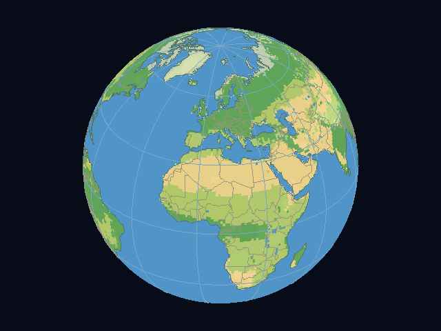
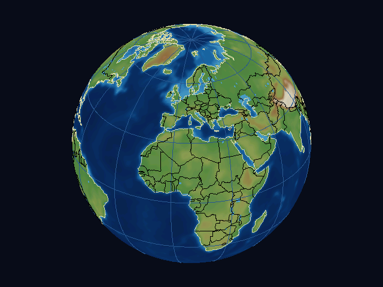
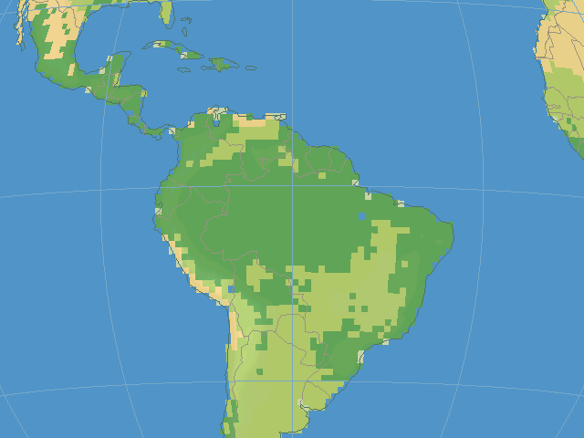
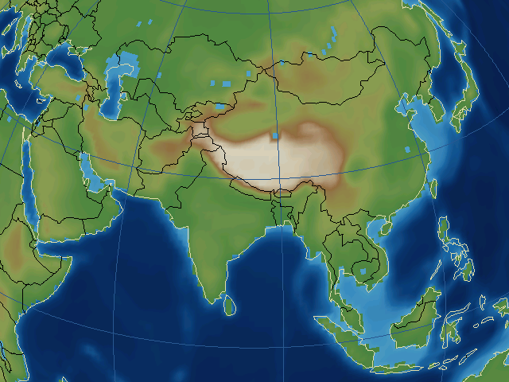
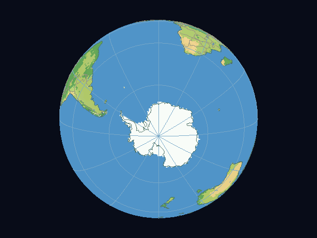
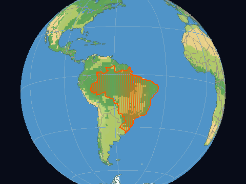
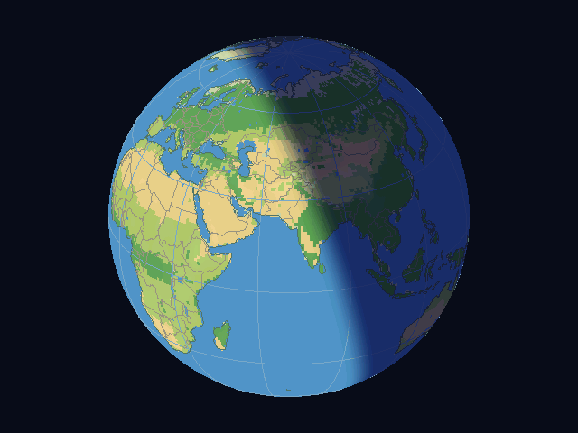
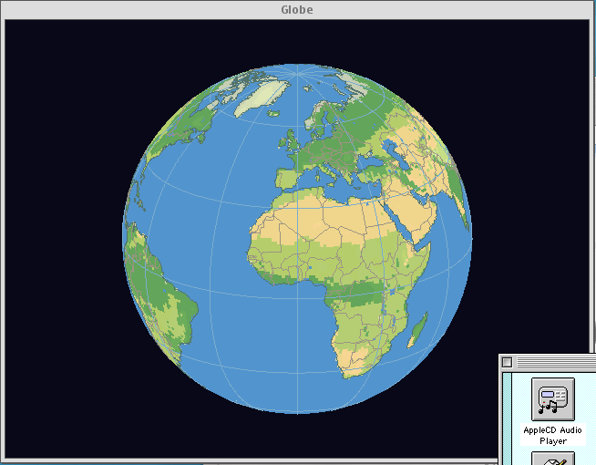

# Globe

An interactive, software-rendered Earth for PowerPC G4: NetBSD/X11 and classic Mac OS 9.
Plain vector lines while you drag; while you zoom, a scaled copy of the last finished frame keeps
the terrain on screen. When you stop, the coastlines, borders and graticule appear first and the
terrain refines outward from the center in circles underneath, with a thin progress bar along the
bottom until it is done. Two looks: **Map** (land tinted by biome class on a blue sea) and
**Relief** (a plain hypsometric tint, white at altitude). Both editions pick countries (orange
outline and dither fill), show city markers and information cards, shade the night side (`D`) and
measure great-circle distances (`M`); the X11 edition also has a toolbar and a looks palette
(`P`). At higher zoom the full edition refines from one-degree to half-degree terrain; the floppy
edition keeps one degree. [Resolution behavior and measured tradeoffs](docs/progressive-resolution-plan.md).

| Map (default) | Relief |
| --- | --- |
|  |  |
|  |  |





`M` (X11) measures: click two points for the great-circle distance and bearing, with the arc drawn between them. `D` (X11) shades the night side from the system clock, with a soft twilight edge:



The OS 9 floppy build in Classic under Mac OS X Tiger on the G4 (2026-11-02):



The other screenshots are headless renders of the bundled data at 640x480 (`docs/images`).

This is work toward v0.1. Earlier X11 builds have been tried by the owner; current headless
checks pass on host and G4. The OS 9 application is built and packaged, and has been run by the owner under Tiger Classic
(2026-11-02) and on **bare Mac OS 9 on the G4** (2026-11-07: about one second to settle, input
checked every 20 ms; [numbers](docs/os9-proof.md)). It still lacks a menu bar, a looks palette and
settled cursors (see the usability epic, issue #35). Real-display timing on X11 remains open.

- [Current handoff](docs/handoff.md) and [prioritized backlog](docs/backlog.md)
- [Architecture](docs/architecture.md), [design and ADR](docs/adr/0001-m2-to-m5-decisions.md)
- [Terrain measurements](docs/terrain.md), [performance history](docs/perf/README.md)
- [Toolchains](docs/toolchain.md) and [OS 9 acceptance](docs/os9-proof.md)

## Build and use

```
cmake -S . -B build -G Ninja
cmake --build build
ctest --test-dir build --output-on-failure
./build/globe-x11
./build/globe-bench --refine --convert --repeat 2 tests/data/bench_drag.txt
```

X11 requires an authorized display; the host UI tests use private Xvfb displays. For sanitizers,
configure a separate build with `-DGLOBE_SANITIZE=ON`. The current host suite has 48 tests.

Drag to rotate north-up; T switches to trackball mode. Wheel, Page Up/Down or +/- zooms, double-click centers
and zooms, arrows turn, N aligns north, G/B toggle graticule/borders, R resets and Q/Escape quits.
S switches the look (Map or Relief) and P (X11) opens a looks palette window; A click without dragging preserves the view; on X11 it identifies a
country (outlined and dither-filled in orange) or nearby city after 0.4 s, unless a second click (zoom) follows. The Style toolbar button is checked for Relief; F2 restores a hidden
toolbar. Exposing or moving a window resends cached pixels. The graticule hides during an active drag.

## Two editions

- `tools/build-edition.sh full`: native X11 executable with embedded atlas, elevation, countries
  and places; local optional elevation packs. [Import](docs/elevation-import.md),
  [toolbar](docs/toolbar.md), [countries](docs/country-format.md), [places](docs/place-format.md).
- `tools/build-edition.sh floppy`: classic PowerPC OS 9 application with atlas and one-degree
  elevation, countries and cities; no toolbar, palette or menu bar yet. It emits a MacBinary application,
  a real 1.44 MB HFS image and a checked [size report](docs/floppy-size.md).

Both use the same portable core and strict pack formats. Terrain is currently raw embedded v1
data; [compression has been measured](docs/perf/compression.md), with runtime adoption still open.
There is no fetch implementation yet; [the fetch design](docs/fetch-design.md) is for review.
No relay is planned. Sources and attribution are in [data/SOURCES.md](data/SOURCES.md).

`tools/probe-retro68.sh` compile-checks the portable code for PowerPC and 68k. License:
GPL-3.0-or-later. The historical v1 prototype is retained as tag `v1`.
