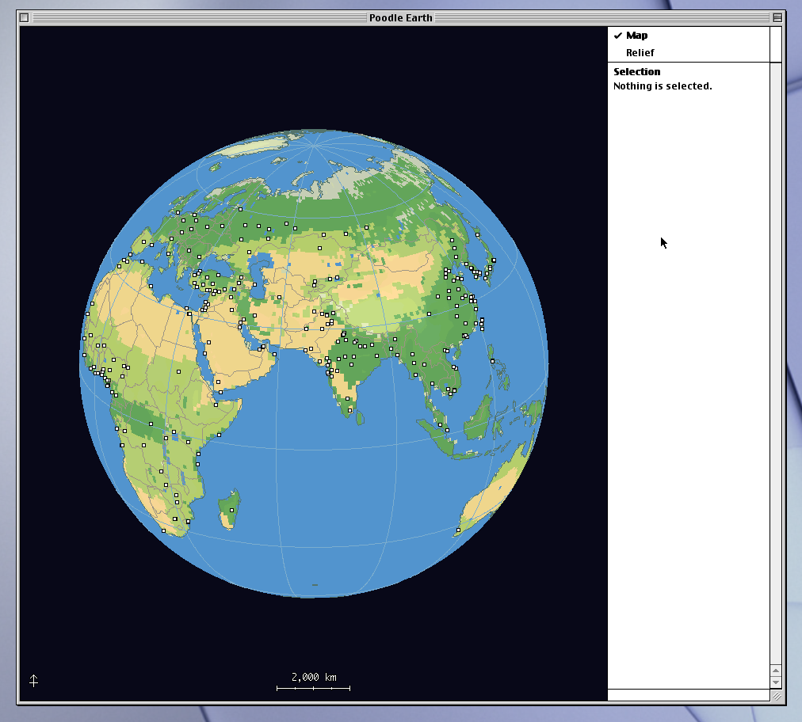

# Poodle Earth

An offline globe for PowerPC Classic Macs. Turn the Earth, explore countries and
cities, switch between **Map** and **Relief**, shade the night side and measure
great-circle distances. All geographic data are built in; no network connection
is used.

**[Download Poodle Earth v0.1.1](https://github.com/jackwillis/poodle-earth/releases/tag/v0.1.1)**

Choose a StuffIt (`.sit`) archive or a hybrid CD image (`.iso`). The release page also includes matching source and checksums.

[Website](https://jackwillis.github.io/poodle-earth/) ·
[User guide](docs/user-guide.md) · [Changelog](CHANGELOG.md)



Captured on a Power Mac G4 under **bare Mac OS 9.2.2** on November 17,
2026, using development build `110a197`.
[Original captures and conversion provenance](docs/images/os9/README.md).

## Install and explore

1. Download the `.sit` from the release page and expand it with **StuffIt Expander
   on the Mac**. Keep the application, ReadMe, both License files and DataCredit
   together in a folder on your hard disk.
2. Double-click **Poodle Earth**. Drag to turn the globe, double-click to center
   and zoom, and click a country or city for its information card.
3. Choose Map or Relief in the sidebar or View menu. Use `+` / `-` to zoom,
   `D` for night shading and `M`, then two clicks, to measure a distance.

Use Finder to copy the application: it needs both its data and resource forks.
For a compatible PowerPC emulator, use the ISO download: attach it as a **CD-ROM**, open the volume in Finder, drag the application
and accompanying documents to the guest hard disk, and launch the copy. This
avoids StuffIt. See [installation and troubleshooting](docs/user-guide.md)
and the [CD guide and exact test evidence](docs/os9-cd-image.md).

## Platforms and limits

The published v0.1.0 preview was tested on a **Power Mac G4 AGP, 467 MHz,
256 MB, bare Mac OS 9.2.2** ([acceptance #95](https://github.com/jackwillis/poodle-earth/issues/95)).
Its application memory settings are 24 MB preferred and 12 MB minimum. Quit the
app before changing these in Finder's Get Info > Memory; larger windows need
more memory.

Later QuickDraw-cursor previews were smoke-tested by Jack in Infinite Mac on
PowerPC System 7.1.2, 7.5, 7.5.3 and Mac OS 7.6, 8.0, 8.1 and 8.5.
These are [build-specific emulator observations](https://github.com/jackwillis/poodle-earth/issues/174#issuecomment-6969352476),
not a compatibility certification for the original download. The application is
PowerPC only; a 68k compile probe does not provide a 68k app. Tiger Classic runs
are separate from bare OS 9 tests.

The compact data set has 1:110 million-scale coastlines and borders, one-degree
terrain and 304 cities. Small islands, small countries and many cities are
missing; names are ASCII. There is no street map, data download, saved preference
file or custom application icon. The v0.1.0 preview can leave an unfinished globe
edge; turn or zoom to repaint it. Jack later reported sustained use without
recurrence, without a structured regression test. See the [changelog](CHANGELOG.md)
for changes after v0.1.0 and [v0.1.1 notes](docs/release-notes-0.1.1.md).
[Draft v0.1.2 notes](docs/release-notes-0.1.2.md) describe an unpublished
candidate; the current download above remains v0.1.1.

## Build and contribute

The source also builds a NetBSD/Linux **X11 frontend** with a toolbar, looks
palette and optional local elevation packs. It shares the rendering core but
has different window controls and shortcuts; Classic instructions do not imply
full frontend parity. It is a source-build path, not a published Unix download.

With a C++20 compiler, CMake, Ninja, Python 3 and X11 development libraries
(and Xvfb for display tests):

```sh
cmake -S . -B build -G Ninja
cmake --build build
ctest --test-dir build --output-on-failure
./build/globe-x11
```

The last command needs an authorized X display. To install the executable and its
notices under a prefix (the binary embeds its data and needs no other files):

```sh
cmake --install build --prefix /usr/local   # honours DESTDIR for staging
```

Start at
[Contributing](CONTRIBUTING.md) for verification expectations,
[toolchains](docs/toolchain.md) for Retro68/Classic builds, and the
[documentation index](docs/README.md) for architecture, formats and research.
Internal names such as `globe-x11` and the `globe` namespace remain unchanged.
The repository is `jackwillis/poodle-earth`; the public rename is tracked in
[#124](https://github.com/jackwillis/poodle-earth/issues/124).

Free software under **GPL-3.0-or-later**. Geographic data have separate licences:
[data sources](data/SOURCES.md), [data credits](data/DATA-CREDITS.txt).
