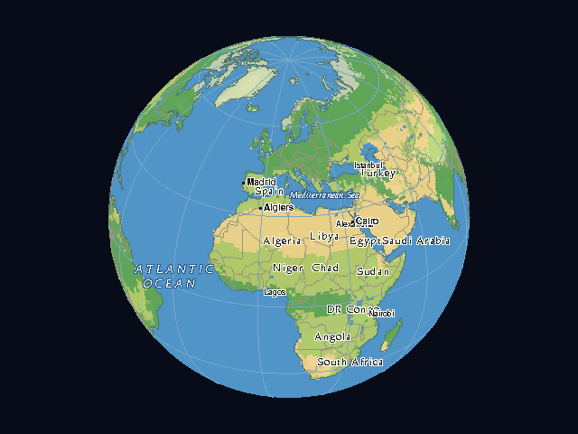
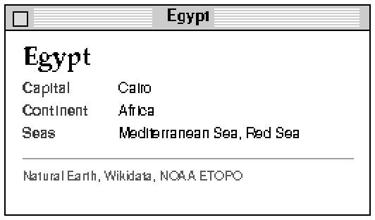
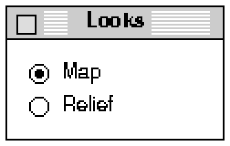
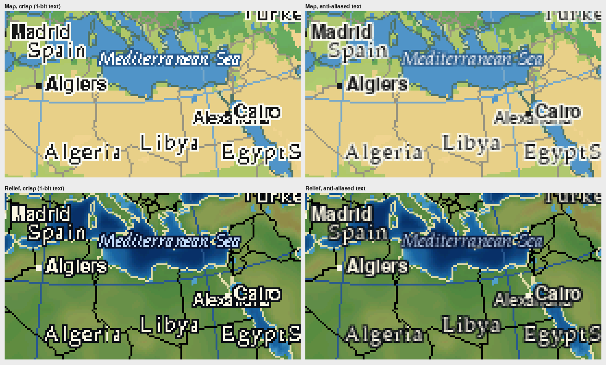

# Typography direction: Helvetica and Palatino

**Status:** the pairing and the "system fonts only" rule are the owner's decisions (2026-11-07).
Everything else in this note is a proposal for experiment, marked as such. Written from the ChatGPT
interagent brief of the same day; research and mockups by a Claude cloud session. Nothing here
changes code, data formats or fonts in the tree.

**One line:** a late-classic Macintosh interface around a readable, traditional atlas. Helvetica is
the Macintosh application (clear, functional); Palatino is the atlas (warm, editorial, cartographic).

## Owner-endorsed versus proposed

| Decided by the owner | Still proposed |
| --- | --- |
| Helvetica and Palatino are Globe's typographic foundation on Classic Mac OS 9 | Which element gets which font, size, style and fallback |
| Use the fonts the system already has, honestly, and bundle no font data, to save bytes, memory and draw time | How map labels are laid out and drawn over the frame (below) |
| Unix (NetBSD/X11) may use a different font stack | What the Unix stack is |

Choosing system fonts also settles the licensing question: nothing is embedded or redistributed
(see Licensing).

## Three text surfaces

| Surface | Drawn by | Font source | Notes |
| --- | --- | --- | --- |
| A. Classic Mac chrome: menus, palette, info card, dialogs | Toolbox / QuickDraw | Fonts installed on the user's Mac | Must cope with a missing font |
| B. X11 chrome: toolbar, palette, info window | X11 (core fonts today) | Fonts on the Unix machine | Own stack; no need to match OS 9 |
| C. Map labels over the globe | The platform's text calls, on the shown frame | The same system fonts as A or B | Layout in the core, drawing per platform |

## Proposed roles

| Element | Surface | Font and style | Note |
| --- | --- | --- | --- |
| Menus, standard controls, dialogs | A | System-managed (native) | Do not override Toolbox conventions |
| Looks palette, readouts, status, diagnostics | A, B | Helvetica, or the system font where the control is native | Coordinates and measurements in Helvetica |
| Country names | C | Palatino Roman, mixed case, light letterspacing | Serif for areas |
| Oceans, seas, lakes | C | Palatino Italic, wide letterspacing | Italics for water is a long-standing convention (see below) |
| Cities | C | Helvetica, one size or two by rank | Sans for points |
| National capitals | C | Helvetica Bold plus a square marker | Weight alone is subtle at 9 px (see mockup), so pair it with a symbol |
| Info-card heading | A | Palatino Bold | |
| Info-card body | A | Helvetica | |
| Mountain ranges, rivers | C | Not decided | No such layer yet; decide when #52/#53 produce one |
| Globe wordmark | | Not decided | Revisit when there is a place to show it |

One rule sits behind it: serif for areas, sans for points. That matches the general practice that
typeface is used mainly to tell feature classes apart.

*Hand-placed illustration on the existing 640x480 render. Positions are not derived from the data,
and the collisions (Egypt against Saudi Arabia, Alexandria against Cairo) are left in on purpose:
they are what placement has to solve. The fonts are open look-alikes (Nimbus Sans, P052) used only to
judge layout, not Helvetica or Palatino; on a real Mac the text is Apple's own rendering.*

## Surface A: Classic Mac chrome

- **Do not hard-code font numbers.** Apple's Font Manager documentation says to refer to a font by
  name, not family ID, because IDs differ between systems ([Storing a Font Name in a
  Document](https://developer.apple.com/library/archive/documentation/mac/Text/Text-202.html)). The
  historical constants list Helvetica as 21 but have no Palatino entry ([Summary of the Font
  Manager](https://developer.apple.com/library/archive/documentation/mac/Text/Text-277.html)).
- **Detect a missing font.** `GetFNum` returns 0 for a font that is not installed, and 0 is also the
  system font, so compare the name afterwards ([GetFNum](https://developer.apple.com/library/archive/documentation/mac/Text/Text-225.html)).
  Proposed fallbacks: Helvetica to Geneva, Palatino to New York or Times.
- **What is installed.** Alan Wood's list shows Palatino, Geneva, Charcoal, New York, Times and
  Chicago with Mac OS 9, and Helvetica with Mac OS 9.2 ([source](https://www.alanwood.net/fonts_mac.html)).
  That page is about Unicode coverage, so the Helvetica entry may describe an extended version and an
  older Helvetica may be present on earlier systems. **Not verified on hardware.** Do not assume
  identical files or variants across installs.
- **Sizes.** Classic bitmap fonts exist at fixed sizes and scale poorly without an outline. Pick
  label sizes that are installed (experiment E1).
- Menus and standard controls stay system-managed.

*Info card mock-up at 2x (Palatino-style Bold heading, Helvetica-style body), with look-alike fonts.*

*Looks palette mock-up at 3x. Real controls would use the system font.*

## Surface B: the Unix stack

The X11 front end already draws with X core fonts (see [toolbar.md](../toolbar.md)).

- Proposed: choose by XLFD pattern with a fallback list, never a single font.
- The X.Org Adobe bitmap font set carries Adobe and DEC notices that permit use, copying,
  modification and distribution provided the notices are kept
  ([Debian copyright file](https://metadata.ftp-master.debian.org/changelogs/main/x/xfonts-75dpi/stable_copyright)).
  I did not confirm the families in that package from a source; to my knowledge it has a Helvetica
  but no Palatino. These would be fonts the machine already has, not fonts Globe ships.
- A serif for areas without Palatino: New Century Schoolbook, Charter or Utopia. Unverified here.
- **To check on NetBSD:** `xlsfonts` on maul, and whether fontconfig or Type 1 URW fonts are installed (E5).

## Surface C: map labels with system fonts

Because no glyph data is bundled, labels are drawn by the platform's own text calls over the shown
frame, and the core does the layout. What follows from that:

- **Pixels differ by machine.** Labels depend on the installed fonts and, on a Mac, on the font
  smoothing setting (to verify). The app cannot force crisp or anti-aliased text. The framebuffer,
  its checksums and the pins are untouched, because labels are not part of them.
- **Placement stays testable.** Placement is a pure function of the candidates, the view and a text
  measuring interface that the platform supplies. Tests run it with fixed fake widths and check the
  resulting boxes, not pixels. #36's request for a shared text function with a pixel golden becomes
  a shared placement function with a layout golden.
- **Draw path.** Two choices to try: draw into the offscreen copy before it is presented, which avoids
  flicker, or draw on the window after the copy and redraw on update events (E6).
- **Cost.** There is no glyph storage and no blend code. The cost is the platform's text drawing, and
  a halo means extra draws per label (E2, E3).
- **Wrong or missing fonts** fall back to the closest installed font and the labels still work, with
  placement based on whatever the platform measures.

If the owner ever wants identical pixels everywhere, the alternatives are hand-drawn bitmap glyphs
owned by the project (no licence issue), or look-alike fonts such as URW Nimbus Sans and P052 (AGPL-3
with an exception for PostScript and PDF documents, per the [Debian copyright file](https://doc.duckcorp.org/cgi-bin/dwww/usr/share/doc/fonts-urw-base35/copyright))
or TeX Gyre Heros and Pagella (GUST Font License, based on the LaTeX Project Public License 1.3c, per
the [Launchpad copyright file](https://answers.launchpad.net/ubuntu/lunar/+source/tex-gyre/+copyright)).
Their compatibility with a GPL-3.0-or-later program is not verified. Not proposed.

## Licensing

- **Using installed fonts** involves no redistribution by Globe.
- **Embedding is the problem to avoid.** Palatino was designed by Hermann Zapf in 1950, and the
  Palatino Linotype outline data is owned by Heidelberger Druckmaschinen AG, represented by Linotype
  Library GmbH ([Microsoft font page](https://learn.microsoft.com/en-us/typography/font-list/palatino-linotype)).
  A Monotype end-user licence (one hosted copy, [EULA](https://thaifaces.com/resources/license/EULA-Monotype-Font-Software.pdf))
  defines font software to include bitmap representations, forbids converting it or making
  derivative works, and allows embedding only in documents. If Apple's Helvetica and Palatino are under
  similar terms, rasterizing them into glyph data in the repository or a binary would need a written
  licence. I could not read Apple's own licence; this is not legal advice.
- **The mockups** were made with URW look-alike fonts as local stand-ins. The fonts are not in the
  repository and the images show rendered text only.

## Cartographic conventions

From the general references on map typography ([overview](https://en.wikipedia.org/wiki/Typography_(cartography))):

- Typeface mainly separates feature classes; italics are common for water; capitals are sometimes
  used for larger features or national capitals.
- Letterspacing should be sparing and even, and is discouraged for line labels.
- Halos help where labels cross detail; horizontal text reads best; legibility comes first.

I read a summary, not Imhof or a historic atlas directly. The atlas references to compare against
still need to be chosen by the owner.

## What the mockups showed

The mock-ups used 1-bit and anti-aliased text from outline look-alikes. With system fonts the app
does not choose between them, but the other findings still apply:

- **Halos are needed on Relief.** Plain text over the shaded terrain was hard to read without a 1 px outline.
- **Serif size.** A serif at 11 px was legible but marginal; sans at 9 px was fine. This was on a
  desktop screen with look-alike fonts, so the G4's display and real Palatino sizes must be checked.
- **Collisions are certain** at 640x480 with a dozen labels; #38 must resolve them deterministically.
- **Capital weight is not enough.** 10 px bold against 9 px regular is barely different. Use a marker.
- **Rough 1-bit text** from an outline at 9 to 11 px is why installed bitmap sizes (E1) matter.

## Practical constraints

- Turn budget: labels must fit the per-turn budget (under 20 ms on bare OS 9).
- Moving or refining: whether labels show only when settled or also over the zoom preview belongs to #38.
- Text encoding: QuickDraw strings are Mac Roman, while data names are likely UTF-8. Some letters
  (Turkish, Polish and others) may lack a Mac Roman glyph. **Check the character set** before
  settling which names can be shown.
- Geographic priorities come from #52/#53 (identity, selection, label priority). Typography consumes
  them and hard-codes no rankings.

## Experiments, with acceptance criteria

| # | Experiment | Done when |
| --- | --- | --- |
| E1 | Which Helvetica and Palatino sizes exist as bitmaps or outlines on the G4, and how they read at 9 to 12 px | Size list and screenshots recorded for bare OS 9 and Classic on Tiger |
| E2 | Halo method (offset draws or other) on Relief and Map | Choice recorded; no label unreadable on the standard views |
| E3 | Cost of a screenful of labels | Milliseconds on bare OS 9 within the turn budget |
| E4 | Font inventory on the G4 (names, sizes) | List recorded for both OS states; fallbacks confirmed |
| E5 | `xlsfonts` and fontconfig on maul for the Unix stack | List recorded; Unix stack chosen |
| E6 | Draw path: offscreen copy before presenting versus on the window after | Flicker and cost recorded; choice made |

E1 and E3 to E6 need the G4 and the owner's authorization.

## Backlog

Linked, not duplicated: #36 (text foundation; its scope changes under the system-font decision),
#38 (labels), #37 and #39 (readout, scale bar), #45 (palette), #44 and #46 (cursor, menus), #52 and
#53 (data and label priorities). No typography epic; this fits under #35. One focused issue covers
font roles, lookup and fallback for platform chrome and labels, which none of the above owns.
