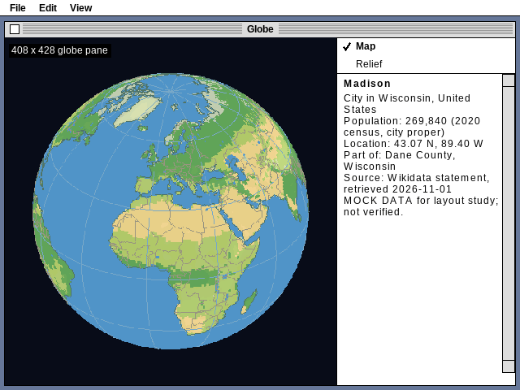
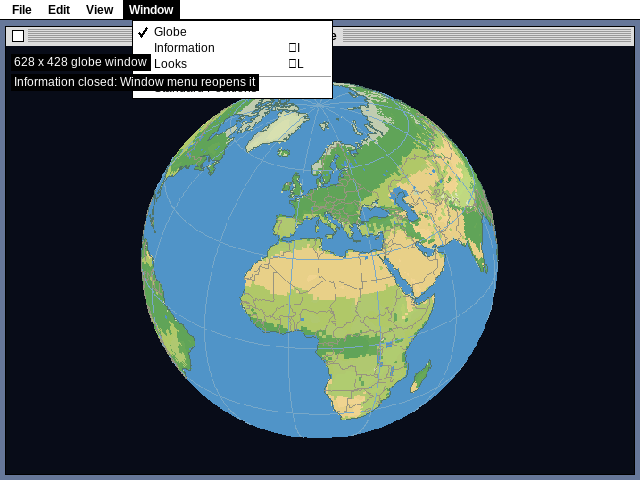
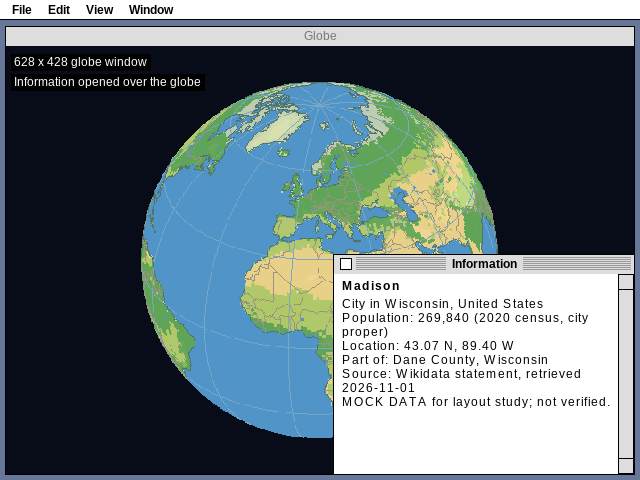
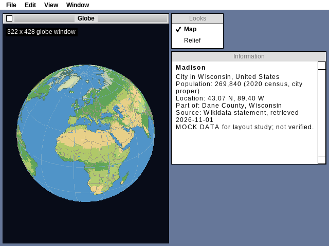
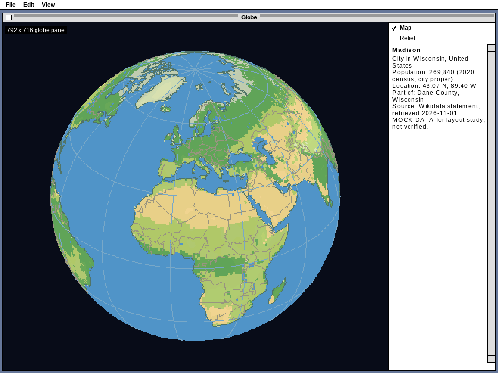
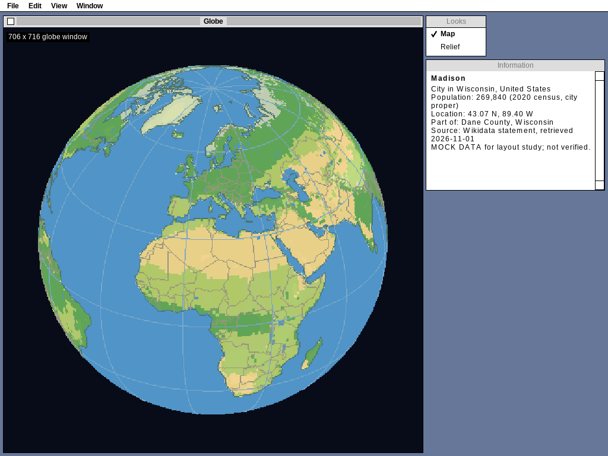
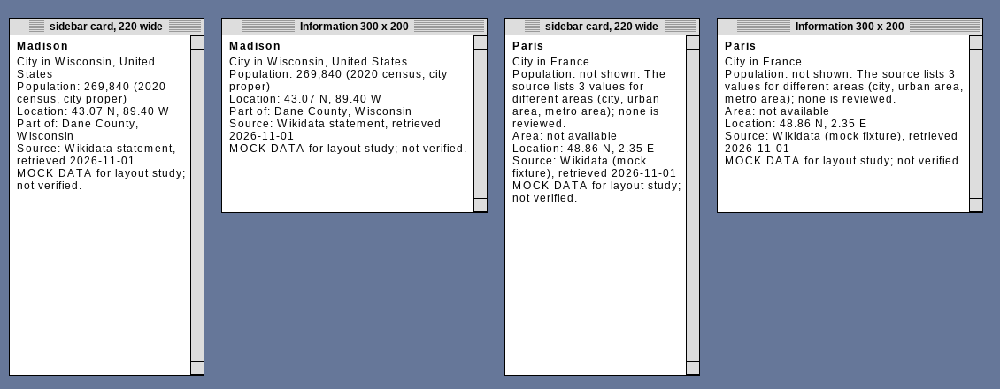
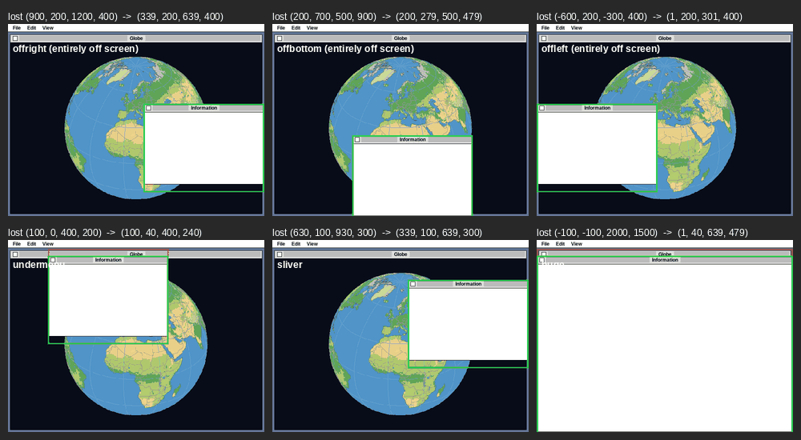

# Workspace usability experiment (#148): evidence before the multi-window slice

**Status:** research, host only. Refs #148. Nothing here changes the product, the release scope or a
milestone, and nothing was run on the G4 or any Mac. The approved direction is unchanged: one
native multi-window workspace (Globe, Information, Looks). This note tests *how* to lay it out.

Reproduce: `python3 tools/workspace-prototype/render_mockups.py` (needs Pillow, a C++20 compiler
and an installed Liberation Sans; fonts are looked up, never bundled) and
`ctest --test-dir build -R workspace_layout`.

## Recommendation

1. **The sidebar does not fail on legibility, so #119 and #137 need not wait for the workspace.**
   At 640 × 480 the sidebar card shows 25 rows and the sourced-facts card needs 11 to 13 even at a
   deliberately pessimistic font width. Section 2.
2. **Build the workspace after #119 and after #137's first slice, not before.** Nothing in the
   evidence pulls it forward, and the slice touches the same `main.cpp` window and event code that
   #119 draws labels from. Section 7.
3. **A plain 300 × 200 Information window is enough for the #137 card but has little headroom.**
   It shows 12 rows; the facts card needs 8 to 11. A later Inspector-style card needs 18. Start at
   300 × 240 (15 rows) with a grow box. Section 2.
4. **At 640 × 480 beside-layout is a net loss and overlap is a focus fight.** The globe is 322
   pixels wide beside a 300-pixel window, against 408 in the sidebar layout today; or Information
   hides 20 percent of the globe disc. Start Compact: Information closed, globe 628 × 428 (54
   percent more pixels than today). The owner should accept or reject that trade explicitly
   (section 3).
5. **The existing text card is a sufficient content contract for the container swap.** Qualified
   facts, provenance and links need two small later additions, not a new contract now (section 5).
6. **Three questions need a native probe before the slice is final** (section 6). They are the
   whole of what this note cannot settle.

## 1. What was inspected

- `AGENTS.md`, `CLAUDE.md`, #148 with its owner comment of 2026-11-16, closed #77 and #79 with their
  comments, #95's acceptance record, #137 and its Inspector follow-up comment, #90 and
  `docs/ui-audit-2026-11-09.md`. PR #150 was read (three documentation files) and not touched.
- The three-window implementation, commit `be9823a` (branch `claude/workspace-layout-77`), and the
  single-window replacement `737b27b` (#79).
- Today's code on `origin/main` 0b5b16d: `src/platform/os9/{main,sidebar,about_window,prefs_window,
  menu_bar}.cpp`, `src/platform/common/classic_window_fit.hpp`, `include/globe/{wrap,card_text,
  countries}.hpp`.

**Why #77 was replaced.** The record is thin. #79's own text says a single window is "more natural
... no window placement or focus juggling, nothing that can land off-screen", and the owner asked
for it on 2026-11-09 after testing the three-window layout. #77's agent comment says that layout
was "not yet run on the G4"; the record does not say what the owner saw. What the code shows is
that #77 had real defects to design around:

| #77 behaviour (`be9823a`) | Lesson |
|---|---|
| Placement computed once at launch from `qd.screenBits` (not the main device), fixed `kGap`, no re-flow | Use the main device rectangle and a rule that also runs on Show (section 4) |
| `show(card, Rect)` created, updated and sometimes placed the window | Separate create, update and place; updating a card must be a pure content change |
| Looks palette re-show called `SelectWindow` (focus steal); Info used `ShowWindow` only | Never activate on content change; activate only on an explicit user command |
| Palette names hard-coded English (`"Map"`, `"Relief"`); the sidebar uses `tr(Str::...)` | Reuse the sidebar's localized rows, not the old palette code |
| `noGrowDocProc` windows: not resizable, so a short screen clips the card | Information gets a grow box |
| `P` key opened the palette; the palette was a window nobody could find if closed | Window menu entry per window (section 3) |

**What can be reused from #77 and today's code:** the scroll bar handling (`TrackControl` without an
action proc, one step per press, dimming on deactivate), `nothing_selected_card()`, and, more than
either, the `AboutWindow`/`PrefsWindow` pattern already on main: create on demand, `close()` hides,
update events repainted, `File > Close` enabled when such a window is in front, `DragWindow` with
a limit rectangle. The Information window is the same pattern with a card in it. Do not restore
`info_card.cpp` or `looks_palette.cpp` as written.

## 2. The comparison

Method and honesty: window rectangles come from the tested geometry in
`tools/workspace-prototype/workspace_layout.hpp`; card text is wrapped by a Python transcription of
`include/globe/wrap.hpp`; metrics are Liberation Sans (Helvetica widths) at 12 px with every glyph
advance multiplied by a factor and rounded to whole pixels, as Quickdraw would. The factor stands in
for the unknown Classic system font (Chicago or Charcoal are wider than Helvetica; **no such font
is installed here, so 1.2 is an assumption**; 1.0 and 1.4 bracket it). Window chrome and the globe
picture (the README 640 × 480 render, rescaled) are illustrative. **All fact numbers are mock data**
and each card says so; none was checked against a source.

| | Sidebar (A) | Workspace (B) |
|---|---|---|
| 640 × 480 |  | Compact, Information closed, Window menu open:  |
| 640 × 480, Information on | (always on) | Opened over the globe:  Naive beside:  |
| 1024 × 768 |  |  |

Card comparison, same cards in a 220-wide sidebar and a 300 × 200 window:

### Globe space

| Screen | Layout | Globe pane | Pixels | vs sidebar | Buffer at 11 B/px |
|---|---|---|---|---|---|
| 640 × 480 | A sidebar | 408 × 428 | 174,624 | 0 | 1.9 MB |
| 640 × 480 | B Compact, Information closed | 628 × 428 | 268,784 | +54% | 3.0 MB |
| 640 × 480 | B Compact, Information open over globe | 628 × 428 | 268,784 | +54% (20% of the disc hidden) | 3.0 MB |
| 640 × 480 | B naive beside | 322 × 428 | 137,816 | −21% | 1.5 MB |
| 1024 × 768 | A sidebar | 792 × 716 | 567,072 | 0 | 6.2 MB |
| 1024 × 768 | B beside | 706 × 716 | 505,496 | −11% | 5.6 MB |

Two consequences. The workspace is not a bigger globe on a big screen: Information at 300 wide takes
86 pixels more than the 220-pixel sidebar did, so the gain is that the user can close or move it,
not that the default is larger. And at 640 × 480 a closed Information window grows the pane by
about 1 MB of buffers (the `kBytesPerPixel` estimate in `classic_window_fit.hpp`) and by 54 percent
of the pixels to render, which affects settle time and the 12 MB partition. Both want a G4
measurement; `fit_classic_window_to_heap` already takes the sidebar width as a parameter and
would be called with 0.

### Card readability and scrolling

Rows needed (wrapped), per card and font factor. The sidebar wraps at 192 px, the 300-wide window
at 272 px (both minus margin, 16-px scroll bar and slack, as `Sidebar::rewrap` does).

| Card | Font stand-in | Rows @ sidebar | Rows @ 300 window |
|---|---|---|---|
| city (facts: 6 lines) | Helvetica-like 1.0 / assumed 1.2 / very wide 1.4 | 9 / 11 / 13 | 6 / 8 / 9 |
| ambiguous (population withheld) | 1.0 / 1.2 / 1.4 | 11 / 12 / 13 | 9 / 9 / 11 |
| country (facts: 7 lines) | 1.0 / 1.2 / 1.4 | 12 / 12 / 13 | 9 / 10 / 11 |
| today's real country card | 1.0 / 1.2 / 1.4 | 8 / 11 / 12 | 7 / 7 / 8 |
| Inspector-style stress card (18 lines) | 1.0 / 1.2 / 1.4 | 18 / 19 / 23 | 14 / 18 / 18 |

Rows visible with no scrolling (22 px header, 14 px rows): sidebar at 640 × 480, **25**; sidebar at
1024 × 768, **46**; Information 300 × 200, **12**; 300 × 240, **15**; 300 × 280, **18**.

Findings:

- **Sidebar legibility passes** for every #137-slice card at every factor (≤ 13 of 25 rows, no
  scroll) and also for the stress card (≤ 23 of 25). Even at the 256-pixel minimum window height the
  card keeps 13 rows. This is the answer to the #148 gate: it does not fail, so the minimal
  Information window is not pulled forward.
- **300 × 200 passes for the facts cards** (8 to 11 rows of 12) **with 1 to 4 rows to spare**, and
  scrolls for the stress card. It shows *fewer* rows than the sidebar at 640 × 480 (12 against 25)
  although it is wider. 300 × 240 gives 15 rows and still fits the Beside column (20 + 48 + 6 + 20 +
  240 = 334 of 428 available). The unit of failure is height, not width.
- The "ambiguous" card is the realistic worst case for #137: a withheld number plus the reason is
  the longest line. Keep each fact line under about 60 characters.
- The missing-value row (`Area: not available`) and the withheld-population row read clearly in both
  containers, and the `MOCK DATA` footer is last, so it is the row that scrolls away first. #137
  should put the source line last and keep it short for the same reason.

## 3. The #79 problems, one at a time

Evidence class: **H** host-derived (geometry, text metrics, tested rules), **C** from reading
code or headers, **N** needs a native probe.

| Problem | Finding | Class |
|---|---|---|
| Initial placement | Use `GetMainDevice` bounds and `GetMBarHeight` (main already does). Two arrangements chosen by one rule: **Beside** if the globe keeps at least the 408-pixel pane the sidebar leaves it and the column fits (screens at least 726 wide and, with a 200-high Information window, 346 tall), else **Compact**. 800 × 600 is Beside (globe 482 wide). | H |
| Globe viewport visibility | Compact gives the globe the whole desktop and starts the others closed, so it is never covered at launch. Beside never overlaps (tested over 512 to 2560 wide by 342 to 1600 tall). | H |
| Auxiliary windows overlapping the map | Information at its Compact home (lower right) hides 20.4% of the disc; the 100 × 48 palette at the upper right hides none. With ordinary document windows an overlapping window that is not in front is hidden by the globe, and one in front is the active window: overlap *is* focus juggling. See section 6, Q1. | H + N |
| Keyboard focus | `key()` returns false unless `FrontWindow() == window_`, so after any click in Information or Looks, arrows and zoom keys do nothing until the globe is clicked. The guard exists to keep About and Preferences from taking globe shortcuts. It must become "front window is not a text-entry window" before Information exists. Copy (`card_text`) already depends on no window. | C |
| Selection updates | `Overlays::take_card()` hands the card over once. With Information hidden the card would be consumed and dropped, and reopening shows a stale card. The window must keep the last card and take every `take_card()` even while hidden (draw only when visible), as `Sidebar::card_` does for Copy. Selection state stays in `Overlays`/`Model`; the window holds a copy of one card, which is a view, not a second selection. | C |
| Close, hide, reopen | Close box hides (as About and Preferences do); the globe has no close command today and keeps none. Reopen from a Window menu entry and a Command key. | C |
| Window-menu discoverability | New **Window** menu: Globe, Information, Looks, a divider, Standard Positions. Checked when visible. Candidate Command keys I and L are free in `menu_bar.cpp` today. The menu is the only place a closed window can be found, so it is not optional. | H (mockup) |
| Clamping and recovery | Section 4. | H |
| Small screens | Compact above. The user can still resize the globe window (grow limits unchanged) and open Information on demand. | H |
| Open by default at 640 × 480? | **No.** Open beside costs 21% of the globe's width relative to today; open over costs 20% of the disc and a focus fight. Closed gives +54% pixels but means a click on a city shows nothing until the user opens Information. See the owner decision below. | H |

**Owner decision needed at 640 × 480, not made here.** Compact means the smallest screen shows
*less at a glance than the sidebar does today* in return for a larger globe. Options: (a) Compact
with Information closed and opened by the user (recommended: nothing hidden, nothing moved);
(b) Compact that opens Information on the first selection, which depends on Q1 and Q2 below;
(c) beside at 322 pixels, rejected on the numbers. Option (b) can be added to (a) later without
rework.

## 4. Window geometry and recovery rules

Implemented and tested in `tools/workspace-prototype/workspace_layout.hpp` (global coordinates,
y down; the unit tests sweep every screen from 512 × 342 to 2560 × 1600).

- Furniture as in `main.cpp`: 20-pixel title bar above content, one-pixel frame, 6-pixel gap.
- **Globe content**: desktop below the menu bar, less the gap and title bar, clamped to the grow
  limits (at least 256 × 256, at most 1600 × 1200). At 640 × 480 this is exactly today's window
  (628 × 428), so Compact changes nothing about the window itself.
- **Beside**: Globe left; a column of 306 pixels (gap plus 300) to its right holding the 100 × 48
  Looks palette over the Information window. Used only when the globe keeps at least 408 pixels and
  the column (20 + 48 + 6 + 20 + height) fits.
- **Compact**: Globe takes the desktop. Information's home is the lower right of the globe and
  Looks' the upper right, both pre-clamped inside the desktop. Both start closed.
- **Grabbable**: a window is grabbable if its whole title bar is below the menu bar and at least
  64 pixels of it (or all of it, if narrower) are on the desktop.
- **Recover**: a window that is not grabbable is moved, and shrunk if larger than the desktop (not
  below its minimum: Information 160 × 80), until its whole frame is on the desktop; a grabbable
  window is left alone, so recovery never undoes a sensible placement. It is idempotent.
- **Where it runs**: when a window is shown from the Window menu, on Standard Positions (re-applies
  `initial_arrangement` to the auxiliary windows only, never resizing the Globe the user sized),
  and if the main device rectangle differs from the last one seen. No window position is written to
  disk (#49).

On how a window gets lost at all: `DragWindow` is called with limit rectangle `{20, -32000, 32000,
32000}` on main today. I could not confirm from headers whether that rectangle limits the pointer
or the window outline (**N**); if it limits the pointer, a dragged title bar always stays under
the pointer and user drags are self-recovering, and the real risks are the programmatic ones:
a display change while running, a second monitor, and later any persisted position. The rules
above cover those either way, and tightening the limit to `desktop()` is free.

## 5. The content contract question

**Can the text card be the content contract while only the container changes? Yes.**

`InfoCard` is a title and up to 21 `string_view` lines. Wrapping (`wrap_card` takes the measure as a
template argument), scrolling, copying (`card_text`) and the card drawing in `Sidebar::draw_card`
use nothing about the sidebar except its pixel width and height. The container swap is
`Sidebar::show(card)` becoming `InfoWindow::show(card)` over the same drawing code, and the same
`take_card()` feeding it. One `Model`, one `Overlays` selection, one renderer: untouched.

What #137 and the later Inspector need beyond that, and when:

| Need | Immediately? | Smallest later addition |
|---|---|---|
| Qualified facts (value, year, definition, source) | No. The builder or `place_card()` formats them into plain lines, as the mockups do. | None |
| **Owned line storage** | **Yes, for #137, in either container.** `InfoCard` borrows; `Overlays` keeps measure text in `char text_[4][64]`. Formatted facts need about six more lines, and #137 forbids "borrowed card text that can outlive a future evictable resource". | A fixed `OwnedCard` buffer (about 21 × 64 bytes) that the window copies into on `show()`; no allocation |
| Entity heading, source footer styling | No. Bold title already exists. | An optional role per line (heading, fact, source), as a parallel array |
| Links (Explore) | No. Needs the entity contract (ADR 0005) first. | An optional entity id per line plus a hit test |
| Collapsible sections | No. Rows are rows. | Section roles on lines and a collapsed flag in the window, not in `Model` |

None of these require a universal widget tree, a second selection or an Inspector now. The first row
that does force work is owned storage, and it belongs to #137, not to the workspace.

## 6. What cannot be validated without native hardware

These are the questions; none is answered by this note. A throwaway Retro68 probe (a window
logger, no product code) on bare Mac OS 9.2.2 *and* 8.1, since #175 fixed startup on 8.1 and the app is meant to keep starting there,
would answer all three in one short session. It needs the owner's authorization for the G4 and is
not requested here.

- **Q1: z-order and activation.** Does `ShowWindow` of a hidden window leave the globe active?
  Does `HideWindow` of the active Information window re-activate the globe? What does a click on
  a visible part of an inactive, partly covered globe return from `FindWindow`, and can the app
  handle it without `SelectWindow` (click-through), keeping Information in front? That app-managed
  "floater" is the only overlap design that avoids a focus fight, because the Retro68 headers on
  this machine (`multiversal/CIncludes`) declare no floating-window procs and no `CreateNewWindow`
  (**C**), and, from memory (not verified here), Window Manager 2.0 floating windows need Mac OS 8.5 or later in any case.
- **Q2: drag without activation.** Does `DragWindow` activate the dragged window unless Command is
  held, as I believe, and does a Command-drag emulation behave on 8.1?
- **Q3: `DragWindow` limit semantics**, as above, and whether windows on a second monitor survive a
  resolution change.

Also not validated: that Chicago, Charcoal or Geneva widths fall inside the 1.0 to 1.4 bracket
(measure with `TextWidth` on the G4); real settle time and memory at 628 × 428; the look of native
Platinum window chrome (the mockups imitate it); the 12 MB partition effect of the larger pane;
and everything about X11 and the FLTK prototype (#183), which this note does not assess.

## 7. Implementation plan: the smallest Classic workspace slice

Scope per #148's own sequencing: Globe, a plain Information window, the existing Looks actions.
No Inspector, no Explore/Inspect/Measure modes, no persistence, no two layouts.

1. **Probe (hardware, owner-authorized, throwaway).** Section 6. Output: a comment on #148 and, if
   it passes, the rule set below unchanged; if Q1 fails, option (a) of section 3 stands and
   overlap is simply not offered.
2. **Extract (no behaviour change).** Move card wrapping, scrolling and drawing out of `Sidebar`
   into a `CardView` that draws into any port and rectangle; `Sidebar` becomes a user of it. The
   existing host tests and `test_wrap` cover the text; the extraction is verified by the sidebar
   looking identical on the G4 before anything else lands.
3. **Geometry.** Promote `workspace_layout.hpp` to `src/platform/common/` beside
   `classic_window_fit.hpp` with its test; call it from `main.cpp` in place of `window_content()`.
4. **Windows.** `InfoWindow` (card view, scroll bar, grow box, hide on close) and `LooksWindow`
   (the sidebar's localized rows, no new strings), both modelled on `AboutWindow`; keep the last
   card across `take_card()`; relax the `key()` guard; `close_front()` and the File > Close
   enable logic extend to the new windows. New **Window** menu and its strings in `l10n/` through `tools/gen_strings.py`.
5. **Remove the sidebar** in the same change (no fallback architecture), call
   `fit_classic_window_to_heap` with width 0, and delete the sidebar-specific hit tests.
6. **Verify.** Host tests (geometry, menus, card text); Retro68 PowerPC and 68k compile
   (`tools/probe-retro68.sh`, `tools/build-os9.sh`); then bare OS 9 acceptance, pending separate
   owner authorization, with the checklist: launch at 640 × 480 and 1280 × 960; click, drag, zoom
   with Information in front; close, reopen, Standard Positions; drag Information past each edge;
   hold the 12 MB partition.

Estimated size: about 300 lines of platform code net (about 150 new for the windows, about 100
for the menu, about 50 changed in `main.cpp`, offset by the sidebar's 177), one new platform-common
header, no new framebuffer, no change to the core or renderer.

## 8. Timing relative to #119 and #137

1. **#119 first** (country names on the map). Independent of any container; it draws on the
   settled globe frame whose pane size the workspace later changes, so landing it first avoids
   re-measuring labels twice.
2. **#137 first-facts slice next**, in the existing sidebar, **under three constraints from this
   experiment**: at most about 8 logical lines and 60 characters per line, so the card stays under
   12 wrapped rows in both containers; the source line last and short; owned, bounded line storage
   (section 5). It proceeds without waiting for the workspace.
3. **The workspace slice after both**, preceded by the probe. If the owner wants the probe earlier,
   it fits the 0.1.2 hardware session without changing any scope.

If a future #137 card exceeds about 20 wrapped rows (the Inspector stress card), the sidebar fails
too, and that is the point at which the Information window grows (300 × 280) or the card paginates;
it is not a reason to build the workspace sooner.
