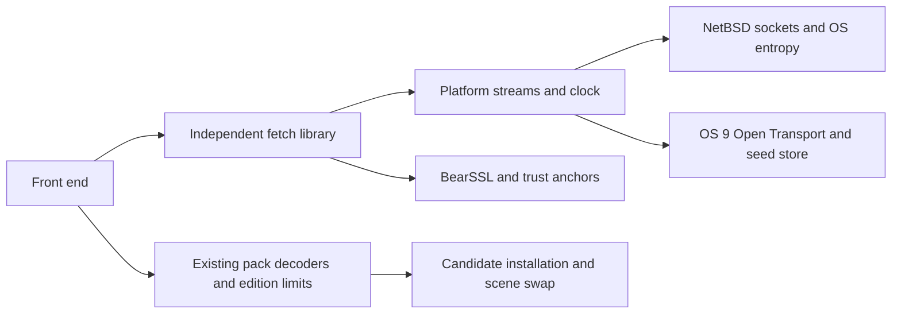

# GL-31: fetch library and pack installation design

Status: **design for review, 2026-11-02**. No networking implementation is added to Globe. This follows
the ADR's fetch-in-app addendum, superseding the older offline-only rule. No relay; two editions;
the separate maps app remains later work. Hosting and UI remain owner decisions. The newer product ADR decides full edition first and
**no fetch on the v0.1 floppy**, pending a first-run seed story and complete feature measurements.

## Reuse boundary and provenance

Reviewed sibling weather at `6256fdd4ea22b61967558de91eb6ec4867a7aed1`, including README,
`docs/OS9-HARDENING-PLAN.md`, `third_party/README.md`, TLS glue, stream seam, HTTP parser and OS 9
seed-store interfaces. Relevant files were clean. Weather's README reports verified TLS under
Tiger Classic and owner-observed native OS 9 use; this pass independently verifies neither.

| Starting material | Proposed treatment |
| --- | --- |
| `third_party/bearssl` | Vendor the same unmodified upstream pin `7bea48e5e850ab4cafbe68d3765cdaba13a86d6f`; retain MIT license, copyright and upstream/source hashes |
| `src/tls/tls.cpp`, `timeconv.hpp`, `secret_clear.hpp` | Extract the byte-stream TLS adapter; replace weather log/status dependencies; own its contexts in the fetch client instead of copying its singleton |
| `src/tls/roots.pem`, `anchors.h`, anchor generation/check tools | Copy with provenance and deterministic generation; retain release-time root fingerprint checks |
| `src/core/net.hpp`, `http.hpp`, `fetch.cpp` | Reuse stream/time-budget concepts and tested framing policy; extract only generic GET pieces, excluding forecasts, providers, queries and weather fallback policy |
| OS 9 `dns_resolve.hpp`, `net_os9.cpp`, `ot_glue.cc`, `ot_min.h` | Adapt the fixed-lifetime resolver/stream lifecycle and own ABI declarations; do not copy system headers or import binaries |
| `seed_pool.hpp`, OS 9 `seed_store_os9.*`, provisioning tool | Share policy and tests, parameterize app-owned paths; keep Globe seed/lock records distinct from Weather |

Weather is GPL-3.0-or-later, compatible with this project's existing first-party license. BearSSL's
MIT notice must ship with a statically linked edition. Preserve the Retro68/Multiversal notices
already required by the application. Proposed first integration is an explicit source import with
an UPSTREAM/provenance record and retained tests, not a build-time dependency on `../weather`.
A separately versioned shared repository can follow if both apps need coordinated updates.

## Library and platform split

A `netfetch` library owns bounded requests, TLS and HTTP byte framing. It includes no `globe/*`,
Model, framebuffer, projection, atlas or window header. It returns bytes/progress/errors; the app
owns pack validation and installation. The same library could serve the later maps app.

Propose BearSSL on both platforms initially, following weather's exercised seam; a system TLS
adapter for NetBSD can be evaluated independently. This avoids implementing two TLS policies at
once. The pinned weather adapter explicitly permits TLS 1.2 with ECDHE/AEAD suites, validates the
original hostname/SNI and supplies certificate time from the platform UTC clock. Keep that policy;
verify the chosen host supports it. No production trust/time bypass, HTTP downgrade or jitter-only
entropy fallback. The three current roots are ISRG X1, ISRG X2 and HARICA TLS RSA Root CA 2021.
Their sufficiency depends on the chosen pack host; a certificate/clock failure remains an error.

Use one active operation/client initially. Contexts/buffers have stable addresses for their entire
operation, following [BearSSL's context ownership rules](https://www.bearssl.org/api1.html).
A request carries a byte cap, timeout policy and cancellation token. The platform provides streams,
UTC and monotonic clocks, entropy, and a bounded foreground-yield hook. No OS headers enter Globe's
portable rendering core. Fetch operation generation is separate from render generation: a camera
drag need not discard a useful pack download.

NetBSD uses nonblocking socket waits with the existing event loop. OS 9 reuses weather's asynchronous
Open Transport DNS state machine, permanent callback storage and foreground completion processing.
A notifier records facts only: no drawing, file I/O, allocations or recursive requests. Cancellation
and timeout latch a terminal result; late callbacks cannot become success. Keep provider-owned
storage alive until close/quiescence is proved, including a late provider returned after cancel.

While an operation is active, bounded waits yield to input and rendering (weather uses roughly
50-ms slices). Prefer readiness/deadline wakes; no repeating idle network timer after completion.
A closing window cancels the operation and observes safe cleanup before freeing callback storage.
OS 9 modal tracking/time-budget treatment must be explicit, retaining weather's tested active-time
policy; it cannot promise that the remote server keeps a socket alive during a long modal hold.

## Seed provisioning and trust lifecycle

NetBSD uses the OS cryptographic entropy source through its adapter. OS 9 initially requires a
unique 32-byte seed generated by a modern OS CSPRNG and delivered through the owner's authenticated
installation route. Never bundle seeds, copy Weather's live seed, log seed bytes or use ordinary
mouse movement as an entropy proof. No seed is read or created by this design pass.

Use Globe-specific Preferences primary/next/lock records with a versioned managed provenance
format. Reuse weather's HMAC_DRBG policy and fault-tested seed-store behavior: hold exclusive
ownership, reject absent/legacy/short/oversized records, persist a successor before releasing the
first TLS entropy, and use distinct generator outputs for TLS and the next saved seed. Check every
read/write/flush/close/replacement result. Never truncate the only valid seed. A failed required
rotation refuses TLS while the bundled globe remains usable. Preserve recoverable old/temp/new
states; do not call replacement atomic or durable before OS 9 crash/relaunch tests establish it.

Clear temporary secrets with the existing compiler-resistant helper. Jitter can supplement a
provisioned seed, not replace it. This does not protect against seed theft, cloned installs or
snapshot rollback. Reuse the [documented HMAC_DRBG API](https://www.bearssl.org/apidoc/bearssl__rand_8h.html),
retaining deterministic synthetic test vectors; output inequality is not a randomness test.

## Binary HTTP and acquisition limits

Weather's current `http.hpp` is an HTTP/1.0 whole-response parser and explicitly has no chunked
support. It cannot simply receive a multi-megabyte binary pack unchanged. First slice: bounded
binary streaming to a candidate file, explicit lengths, identity content encoding, one GET, no
provider fallback. Keep tested rejection of malformed/overflowing/conflicting Content-Length.
Initially reject Transfer-Encoding/chunked responses; add a separately tested chunk decoder only
if the selected host requires one. Never treat a body as a NUL-terminated string.

Proposed limits: 8 KiB response headers, 64 header fields, a small bounded HTTPS redirect count,
no redirect to HTTP, and a body cap chosen before connection from the expected pack type/edition.
The User-Agent contains product/version and a public project URL only; never include the owner's
email in it or any outbound request. Request identity encoding; reject unexpected compressed bodies rather than silently allocating
an unbounded decoded buffer. Size caps apply to streamed bytes even without Content-Length;
short, overlong or ambiguous bodies fail. Use the original authority for each verified connection;
redirect hosts must follow an owner-approved policy. Retain one whole-attempt deadline plus bounded
per-wait budgets; cancelled, certificate and validation failures are not retried automatically.
A later retry/backoff policy belongs in the reviewed fetch controller, not the render core.

## Validate and install without risking baked data

The built-in arrays are immutable and never file destinations. Downloads use generated app-owned
candidate names in the data directory; server filenames do not choose paths. Do not overwrite an
active file or replace a scene while it borrows its bytes.

1. Accept only a supported protocol/status and the expected pack type. Enforce transport/header
   limits during the transfer; remove or quarantine a failed candidate without touching old data.
2. Validate magic, version, flags, exact length, arithmetic/count bounds and stored CRC with the
   existing strict decoder. CRC detects damage; TLS supplies transport authentication, not CRC.
3. Apply tighter edition/resolution and **peak memory** limits before allocation. Format maxima are
   not an entitlement to exhaust a 12-MiB OS 9 partition. Account for current and candidate bytes,
   old/new scene caches, framebuffer/GWorld, TLS contexts and its record buffer. Reject gracefully
   when both generations cannot coexist; leave the current view and baked fallback intact.
4. Construct the candidate scene using failable allocations and bounded preparation. On success,
   cancel any job borrowing the old scene, install on the foreground loop, then issue the normal
   data-change/generation effect. Retire old storage only after all borrowers release it.
5. Persist the validated candidate under a versioned local identity using verified OS-specific
   replacement semantics. Retain the previous optional pack until completion. Startup validates
   optional files again and falls back to baked data for corrupt/unknown versions.

Current absolute v1 byte ceilings (before tighter edition limits) are GELV 16,777,768; GATL 4,266,264;
GPOL 10,162,720; GPLC 1,146,904. Derive these from the canonical format constants rather than duplicating
unchecked arithmetic in a downloader. The elevation importer also enforces global equal-angular
coverage and a 32-MiB terrain-cache payload limit; the OS 9 peak-memory rule must be stricter.
Optional compressed packs wait for a reviewed container with stored CRC and bounded output length.
A malformed file must never be auto-executed or handed directly to a renderer before validation.

## Measured floppy code cost

Local Retro68 GNU 16.1.0, PowerPC `-Os`, matched GL-27/28 application/data and application name.
The experiment only links retained cryptographic APIs and, separately, the three generated anchors.
It runs no TLS session, network operation, provisioning step or sizing executable. The harness stays
in ignored build directories; no network library or dependency is vendored into Globe in this pass.

| Link-only application | Data fork | MacBinary |
| --- | ---: | ---: |
| Current floppy baseline | 237,116 | 237,824 |
| Retained BearSSL client, streams and HMAC_DRBG | 337,076 | 337,792 |
| Above plus three anchors | 341,322 | 342,016 |

Data-fork deltas: **99,960 bytes** for the retained crypto path, **4,246** more for anchors/retention
and PEF overhead, **104,206 combined**. This is not the full fetch feature: DNS/Open Transport glue,
HTTP streaming, seed storage/installer, UI, notices and update installation are excluded. It is also
not a prediction from the archive size. The initial unused-symbol probe produced zero delta and no
TLS symbols; it was discarded. A sizing-only entry call now retains the APIs; XCOFF contains
`br_ssl_client_init_full` and `br_hmac_drbg_generate`. All three builds embed identical elevation bytes.
See [raw measurements](perf/fetch-tls-size-20261102.json).

The component alone fits the current conservative floppy budget. The owner nevertheless excludes
fetch from the v0.1 floppy because seed provisioning for copied disks is undesigned; full edition first. Retained TLS buffers and contexts need RAM too: weather's full-duplex record
buffer is 33,178 bytes before client/verifier/DRBG, HTTP and OT state. A complete candidate must be
rebuilt, HFS-packaged and timed on actual OS 9. The smaller custom cipher-profile opportunity is
unmeasured; do not claim its saving. Full edition first is the owner decision; this does not introduce a third release.

## Review questions and acceptance before implementation

Owner decisions: where are generated packs hosted (and which redirect authorities); which pack
kinds the full edition can fetch; manual URL versus curated catalog; update frequency and rollback policy;
a future OS 9 first-run provisioning UX before any later floppy networking; and whether a separately signed manifest is wanted in addition to HTTPS. Public source
shapefiles/NetCDF are builder inputs, not ready-to-import runtime packs. No host is assumed here.

Implementation gates: host TLS fixture tests for hostname, chain, time, abrupt EOF, cancelled
handshake and malformed HTTP; DNS immediate/late/duplicate completions and cleanup; seed failures,
crash boundaries, relaunch and exclusive ownership; every truncated/corrupt/oversized/unknown pack;
I/O and allocation faults at each install boundary. Assert that old scene bytes/pixels survive every
failed candidate. Repeat big-endian parser/replay checks on the G4, then verify OT lifecycle, seed
rotation and live certificate-verified fetch separately on native OS 9. CI tests use synthetic seeds
and local fixtures; no private seed or shared G4 credential belongs in an artifact. No CI, live TLS or
OS 9 runtime acceptance is claimed by this design document.
