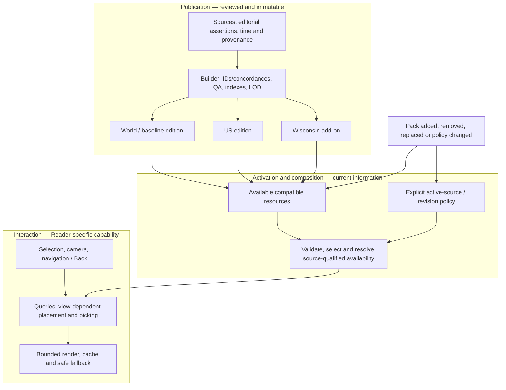

# Poodle Earth — Publication, composition and Reader responsibilities

**Date:** 2026-11-19  
**Status:** Research synthesis for owner review; **non-normative, not an accepted ADR, implementation authorization, release gate or format specification**. This records a bounded conclusion from competing-hypotheses and causal-design consultations; it is **not a newly executed experiment**.

**Question:** What minimum agreement lets Poodle Earth's geographic meaning survive different published editions, active resource sets, Readers and lifetimes, without requiring one implementation or premature format standardization?

**Scope:** The logical boundary among (1) publication, (2) edition activation/composition, and (3) interaction. This note does not decide that those must be separate processes or runtime objects.

**Repository anchors:** [Accepted-in-principle ADR 0003](../adr/0003-atlas-production-boundary.md) (builder/runtime boundary), [draft ADR 0005](../adr/0005-entity-identity-and-navigation.md) and the [entity/navigation contract](../design/entity-navigation-contract.md), [CD-ROM atlas research](cd-rom-atlas-architecture.md), [#52 atlas-production epic](https://github.com/jackwillis/globe/issues/52), [#31 pack/index research](https://github.com/jackwillis/globe/issues/31), [#48 external Classic loading](https://github.com/jackwillis/globe/issues/48). Related, **still-draft and unmerged** host-side research: [EXP-ADE-01 / PR #179](https://github.com/jackwillis/globe/pull/179), [EXP-EDSEL-01 / PR #182](https://github.com/jackwillis/globe/pull/182), [EXP-WI-DATA-01 / PR #187](https://github.com/jackwillis/globe/pull/187). Optional OS packaging is a separate proposal in [draft PR #206](https://github.com/jackwillis/globe/pull/206), not a dependency or an approved runtime schema.

## 1. Final synthesis: the minimum safe boundary

The most useful refinement to the binary **Publisher → Reader** picture is a division into **three logical responsibilities**:

1. **Publication:** Curate reviewed, source-qualified geographic assertions and emit immutable, validated, efficiently queryable representations.
2. **Edition activation and composition:** From what is *actually* installed, compatible, selected, and permitted by the current source policy, establish what information is available for a request.
3. **Interaction:** Interpret user intent, update navigation/history, perform viewport-dependent computation, render and display available information within the Reader's capabilities.

This is not a new three-tier implementation mandate. A sealed edition may have done most composition at publication time. A lightweight Reader may compose simple pack indexes once at activation. A capable workstation may resolve richer queries dynamically.

**Information-availability principle:** Do work at the earliest stage that possesses the necessary inputs *and* can represent the result economically. The publisher may have far more CPU than the Reader but cannot know future optional packs, current source priorities, the available memory budget, the viewport, or future user intent. A **prepared index is not a prepared answer**.

**Working hypothesis, not an architectural verdict:** *Publish expensive, relatively stable geographic knowledge; compose independently available knowledge using small explicit rules; leave interaction-dependent decisions with the Reader.* Judge the **total** cost across production, edition updates, distribution, activation, RAM, I/O and maintenance—not only Reader CPU instructions.

The diagram is a conceptual data-flow sketch. It **does not** imply that the Reader preloads all installed packs, that every pack is trusted, that composition occurs every frame, or that an "active world snapshot" must be implemented as a central catalog.

## 2. Responsibility map and why

| Work or decision | Earliest defensible stage | Qualifier |
| --- | --- | --- |
| Source licensing, verification, reviewed assertions, concordances and canonical ID assignments | Publisher/editorial process | A published claim has provenance and time qualifications; it need not erase legitimate disagreement |
| Geometry simplification, orientation, source normalization, per-pack search/spatial indexes, candidate labels/LOD, static relationships | Publication | Evaluate publication bytes and decode/seek costs, not just CPU saved |
| Edition identities, bounds, integrity checks, compatibility and published dependencies | Publisher declares; Reader verifies | A package-manager checksum is not a substitute for strict Reader validation |
| Which optional editions and revisions exist right now | Activation/composition | Unknown to the earlier publisher |
| Which sources have precedence under selected policy | Activation/composition | Not automatically determined by file enumeration order |
| Available/missing/ambiguous/unapproved/incompatible/retired results | Composition applied to published semantics | Exact statuses still require contract and authority review; never silently rebind |
| Pack and cache residency, safe replacement, lifetime of borrowed data | Reader/resource system | Installed-on-disk and resident-in-RAM are separate |
| Camera, projection, clipping, picking, final label layout, navigation/Back and user queries | Interaction | Dependent on viewport, fonts, input state, query time and Reader capabilities |
| Rich analysis, KML export, editable GIS, Java 1.1 and alternative readers | Optional capabilities | Interchange is a separate boundary from native geographic identity |

A prepared per-pack lookup index can remain immutable. **Choosing which lookup to consult** can still be dynamic. Likewise the builder can prepare time-qualified relationships without deciding which temporal or source-qualified query a user will ask.

## 3. Three deliberately competing architectures

All alternatives must use **identical approved source assertions, IDs, expected outcomes and requested behaviors** for a controlled comparison.

| Model | Composition location | Potential benefit | Discriminating risk |
| --- | --- | --- | --- |
| **A — Publisher-sealed** | Publisher combines a known selected set into a resolved edition | Compact Reader logic, fewer activation reads | An unknown future add-on or corrected relationship may require resealing and redistributing products |
| **B — Independently composable** | Publisher emits indexed specialized packs; Reader activates an explicit compatible subset under bounded rules | Independent installation/removal and potentially localized updates | More metadata, activation work, version/conflict handling and safe lifetime logic |
| **C — Runtime-rich** | Publisher prepares less; Reader builds or computes more indexes and semantic queries | General queries and flexible sources | Startup work, code size, live/peak RAM, especially on Classic Mac |

**Capability-specific publication** is a policy across A/B/C, not a mutually exclusive fourth system. Classic Mac might prefer a curated sealed distribution while a modern workstation accepts composable add-ons, **if** both obey the same limited semantic contract. That possibility also has a measurable maintenance/format-multiplicity cost.

These models are not value judgments. If arbitrary third-party add-ons are not a product requirement for a particular Reader, A's need to reseal is a legitimate capability difference rather than a correctness defect. If C is unnecessary for the Classic Reader, it need not be implemented to prove B.

### An appealing but unproven mechanism: a coherent active view

Activation could publish a small immutable *selection of validated resources and source policy*, tagged with a generation, so interaction uses consistent metadata until a pack/policy change. This is compatible in spirit with existing generation-aware work, but is **not** evidence for introducing a new snapshot class, persistent global catalog, new lifetime protocol or permanent copy of all data. Test simpler representations first, including publisher-sealed files and pack-local lookup tables.

## 4. Minimal semantic agreements common to the models

These are **candidate externally observable properties**, not final ABI, binary schema or an adopted public protocol.

- **Durable, noninferential identity:** A geographic reference must not silently become a different entity when editions, sources or LOD change. Matching names/coordinates are not sufficient to approve a join; project ID allocation and concordance authority belong to reviewed publication policy (draft ADR 0005).
- **Claims distinct from entities:** Relationships, names, geometry, dates and statistics can be source-qualified and disagree. A Reader need not adopt a particular internal database representation to report provenance.
- **Explicit availability/failure:** Incompatible, missing-source, missing-detail, ambiguous, retired/split or unresolved references are not interchangeable. A Reader must never claim an absent optional pack proves that an entity doesn't exist. An absent *and unrecorded* entity cannot be recovered from no information.
- **Deterministic selection for fixed inputs:** The same approved assertions, active pack set, revision and explicit priority policy must not yield a different choice solely from installation or directory enumeration order.
- **Safe lifecycle:** User-visible references are separate from borrowed pack pointers. Invalid, missing, removed or replaced data must not cause silent rebinding or overwrite a newer navigation state; embedded geography remains usable. The specific runtime resource implementation is not specified here.
- **Conformance by observed behavior:** Two Readers may differ in code, data structures, graphical capability and performance yet agree on identity, provenance, supported query results and explicit failure states. Expected answers need independent review, not merely output from the implementation being tested.

**Information limit:** For an entity introduced only by a later optional edition, once that edition is removed the Reader can only retain what it independently saved or what remains in another available trusted source. A stored opaque, authority-qualified reference may be enough to report "unavailable"; it is *not* evidence that the Reader still knows its geometry, history or relationships. Exact persisted-reference guarantees, namespace/publisher policy, and cross-restart behavior remain owner decisions.

## 5. Two bounded discriminating counterexamples

**Fixture scope:** Invented test-only United States → Wisconsin → Madison → Back to Wisconsin plus a *synthetic* add-on-only municipality and source-qualified administrative relations. Reuse the existing [#182 semantics fixtures](https://github.com/jackwillis/globe/pull/182) and [#179 selection fixtures](https://github.com/jackwillis/globe/pull/179); do **not** import unapproved real geographic assertions, create a competing project-wide ID scheme or build a new harness without a need demonstrated by review.

### Counterexample 1 — Previously unknown entity and removable edition

| Step | Observable contract question |
| --- | --- |
| Base world active; add-on-only entity not published there | Is the entity genuinely unknown, rather than incorrectly assumed absent worldwide? |
| Activate the Wisconsin pack | Does the new entity become discoverable only through an approved and source-qualified reference? |
| Select and save a reference; navigate into and back out of the entity | Does history preserve identity independently of current geometry/cache residency? |
| Remove the pack while its reference is stored | Is the outcome explicitly unavailable/unresolved rather than a name-based substitute? What identity bytes, authority or user history survive? |
| Reinstall a compatible updated pack | Can the original reference resolve if the publisher attests to the same entity? Is source/revision drift reported? |

**Important product-policy split:** Session-only saved history, persistent history across restarts and a fully offline placeholder after uninstall are *different requirements*. Decide which one the fixture exercises before comparing A and B. A publisher-sealed edition may need resealing to include the add-on.

### Counterexample 2 — Corrected geographic relationship

Publish one explicitly qualified synthetic relationship linking a municipality to region A; then issue a reviewed correction assigning it to region B while keeping entity ID stable.

Record separately for A and B: which artifacts/indexes are regenerated, total bytes changed and redistributed, whether dependent indexes become stale, what Reader validation or invalidation occurs, and whether old source-qualified/historical assertions remain available when still published. A correction to present-day membership **must not** automatically erase valid historical records.

A model that produces a visually correct answer by silently discarding a conflict has *not* passed semantic correctness.

### Measurement and causal identification

Hold fixed: editorial source assertions, approved IDs, source-precedence policy, installed set and requests, correctness oracle, host and feature-completeness target. Vary the **publication/composition division**. Treat an independent Reader as a **conformance check**, not an equivalent third causal treatment.

**Primary outcomes:** no silent rebinding; provenance and time qualifications; deterministic installation-order independence; explicit unavailable/ambiguous/incompatible states; correct history and source correction.

**Secondary costs:** bytes published/duplicated/redistributed; reads/seeks and bounded lookup steps; resident + **peak live** metadata and replacement buffers; startup work; invalidation paths; distinct semantic implementations and independently maintained contracts. Lines of code alone do not measure maintainability.

A synthetic Python result cannot establish Classic HFS File Manager seek behavior, G4 memory partition costs, real correctness of Wisconsin geographic assertions or long-term contributor productivity. Independently authored expected-output fixtures are necessary to avoid a shared resolver validating itself.

### Stop/go rule

Stop after these **two interventions** if both approaches satisfy required observable outcomes and relevant costs can be explained, or if a remaining verdict depends on owner-selected product requirements or G4/hardware evidence. Do not invent resource thresholds after seeing the results.

- If sealed A and composable B both pass, prefer the simpler mechanism for the intended edition.
- If B handles unknown independently installed data and A requires resealing, record the **capability/cost distinction**, not an automatic global B victory.
- If both fail over unknown authority, stored metadata or disputed-source policy, **stop** and return the precise decision to the owner/editorial process; more runtime infrastructure cannot decide it.
- Explore C or a new catalog only if A/B leave a consequential, answerable question that existing fixtures cannot resolve.

## 6. Evidence ledger: established vs. hypothesis vs. unknown

| Class | Statement and evidence boundary |
| --- | --- |
| **Existing accepted direction** | [ADR 0003](../adr/0003-atlas-production-boundary.md) separates runtime from atlas production, distinguishes entity existence/geometry/presentation, requires robust validation and an embedded offline fallback, and expressly defers container/edition choices |
| **Existing draft proposal, not accepted** | [ADR 0005](../adr/0005-entity-identity-and-navigation.md) proposes canonical refs, concordance review, retired/split semantics and portable navigation state; these are not implemented or frozen by this note |
| **Host synthetic research, not production proof** | [PR #179](https://github.com/jackwillis/globe/pull/179) compared automatic discovery, sealed editions and explicit manifest selection; its claims are specific to synthetic host fixtures |
| **Host synthetic research, not real identities** | [PR #182](https://github.com/jackwillis/globe/pull/182) explored source-qualified claims, reference lifetime, conflict/priority states and edition drift; its fixture assumes an embedded catalog already knows each tested entity |
| **Host and research-data evidence, not general runtime conclusion** | [PR #187](https://github.com/jackwillis/globe/pull/187) favors specialized physical storage over a generic store for certain dense statistics, while retaining unresolved editorial/claim semantics and licensing constraints |
| **Working hypothesis** | Publisher-prepared pack-local indexes + bounded composition may serve independently installable editions without a central runtime semantic catalog |
| **Untested mechanism** | An immutable active-world/resource view might make installation/policy changes safe and cheap; its necessity, representation and costs are **unproven** |
| **Not determined** | Native G4 performance, valid data-file layouts, final ID encoding, source authority, compatibility/version policy, third-party publishing rules or user-data persistence requirements |

The cited PRs are research records, not merged decisions or requirements to reuse their particular mock JSON/fixture encodings.

## 7. Decisions to defer deliberately

Do **not** standardize from this synthesis:

- A universal runtime identity database, shared semantic service, snapshot class, dependency solver or new data-loader API.
- File/container encoding, compression, physical pack layout, manifest syntax, numeric ID width, compatibility ranges or platform package names.
- Final authority over third-party identities, contested administrative membership, source precedence or historical-query policy.
- Guaranteed arbitrary hot installation/uninstallation, persistent navigation history, or a particular UI affordance.
- Java 1.1, WebAssembly, Windows, KML, a complete GIS query engine or a multi-platform CD as shipping prerequisites.
- Any source acquisition or licence, G4 usage, accepted-ADR change, merge, milestone or release commitment.

KML-style interchange may eventually export a *representation* of geographic knowledge; it is not a substitute for project-wide semantic identity. Optional packages describe **distribution**, not how the Reader stores or composes an active atlas.

## 8. Minimal next handoff, within existing ownership

1. Ask the owners/reviewers of [#182](https://github.com/jackwillis/globe/pull/182) and [#179](https://github.com/jackwillis/globe/pull/179) to review **one additive add-on-only identity fixture specification** (including precise survival and missing-resource states) and **one relationship-correction propagation trace**. Reuse their existing test vocabulary; do not independently fork the research infrastructure.
2. Record independent expected outcomes first, then evaluate sealed A vs composable B at equal semantic completeness **only if** a contract-level review leaves an architectural distinction unresolved.
3. Feed outcomes into [#52](https://github.com/jackwillis/globe/issues/52), [draft ADR 0005](../adr/0005-entity-identity-and-navigation.md) and [#31](https://github.com/jackwillis/globe/issues/31) via normal owner review. No changes to those artifacts are implied by this note.
4. Defer real Classic/NetBSD performance and optical media claims to [#48](https://github.com/jackwillis/globe/issues/48), [#26/#54](https://github.com/jackwillis/globe/issues/26) and [#72](https://github.com/jackwillis/globe/issues/72), with separately authorized machine access.

**Owner decision to request before expanding implementation:** Must a user's saved reference to a new add-on-only entity survive removal **only for the current session**, **across application restarts**, or merely remain **non-rebinding while the pack is present**? The requirement determines how much reference/authority metadata must remain available, but not whether it requires a centralized runtime catalog.

**Research conclusion:** The smallest trustworthy publishing artifact is not simply the one with the most precomputed answers. It is the one that supplies reviewed, source-qualified meaning and enough bounded structure for the Reader to make decisions only the Reader has the information to make.
