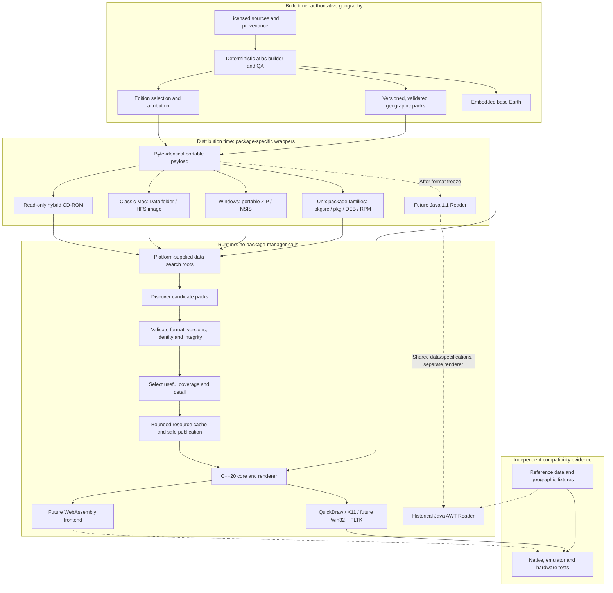

# Portable atlas distribution — architecture proposal and staging experiment

**Status (2026-11-19):** Exploratory distribution design, **not** a locked atlas format, Accepted ADR, approved installer, new platform commitment, release gate, or claim that the runtime already discovers multiple installed editions. Owner review is required before adopting a final format, package namespace, discovery precedence, package manifest, or version policy. This document records a bounded architecture-neutral staging test and research tasks.

Related: [portable frontends](cross-platform-frontends-and-distribution.md), [layered CD-ROM design](cd-rom-atlas-architecture.md), [GATL v1](../atlas-format.md), [architecture](../architecture.md), [licensing policy](../licensing-policy.md), [#31 pack format](https://github.com/jackwillis/globe/issues/31), [#48 external Classic loading](https://github.com/jackwillis/globe/issues/48), [#49 read-only volumes](https://github.com/jackwillis/globe/issues/49), [#50 data contents](https://github.com/jackwillis/globe/issues/50), [#51 edition image](https://github.com/jackwillis/globe/issues/51), [#72 optical retrieval](https://github.com/jackwillis/globe/issues/72), [#176 Win9x research](https://github.com/jackwillis/globe/issues/176).

## Thesis

**Portable atlas artifacts; native distribution.** The builder owns geographic truth, provenance and format versions. A *data pack* is a portable, immutable collection of geographic bytes; an *edition* groups compatible data packs; an OS-specific *distribution package* installs files but does not define their geographic semantics. Package installation, runtime discovery and in-memory resource management are independent operations.

The executable always includes a useful embedded Earth. Optional packs must be safe to omit, corrupt, replace or remove; no data installer is required to launch the baseline application. A large installed dataset is not a promise or requirement to load it into RAM.

## Overall architecture



The diagram marks proposed packaging and runtime adapters separately from *already implemented* pack formats and native application code. The Java branch is long-term and depends on stable formats.

## Contracts worth keeping separate

| Boundary | Authoritative owner | Does not own |
| --- | --- | --- |
| Geographic pack | Versioned builder output and existing strict readers | Unix filenames, installer metadata or user preferences |
| Edition | Curated selection and declared compatibility of packs | Runtime cache size or which pack is loaded right now |
| Package/installer | Native filesystem placement, dependencies, ownership and uninstall | Geographic IDs, coordinate system or pack encoding |
| Discovery adapter | Configured platform search roots and file handles | A package manager interface or network fetching |
| Shared core | Validation, deterministic identity/overlap semantics, resource budgets and rendering | Operating-system installation and registry entries |
| Test evidence | Specific build, pack hashes, OS/CPU/runtime and executed assertions | An unconditional platform-support guarantee |

### Proposed metadata (not a frozen schema)

A future edition descriptor may include a stable pack/edition identifier, independently versioned **content release**, **binary format version**, supported reader versions/capabilities, covered geographic regions, layer/LOD inventory, inter-pack dependencies, per-file SHA-256 for distribution integrity, and source/license attribution. Runtime bounds, version and internal CRC checks remain obligatory even if a package manager has verified installation checksums.

The current GATL/GELV/GPOL/GPLC files are existing pack formats. **Do not** embed a JSON manifest parser into Classic Mac, change their version numbers or commit a new on-disk format merely to support this distribution proposal. Prefer generating package metadata from an eventual authoritative edition declaration, possibly using a more compact bounded reader index when evidence warrants it.

### Paths and discovery (policy proposal)

- Package managers install read-only files below a configured data directory such as `${PREFIX}/share/poodle-earth/packs/` for pkgsrc, `${DATADIR}/poodle-earth/packs/` for FreeBSD or `/usr/share/poodle-earth/packs/` for conventional Linux packages. None is a universal hard-coded runtime path.
- Portable Windows and Classic Macintosh distributions keep compatible data beside the application in a `Data/` folder (Classic path discovery via File Manager); a hybrid disc may expose the same bytes under platform-appropriate directory views.
- User-provided optional data roots, when supported, are explicitly configured and stored separately from application/OS-managed files. Never write caches or preferences into package-owned directories or mounted optical media.
- Resolve installed pack identity and compatibility **before** deciding which detail to use; reject unsupported/ambiguous packs deterministically, log bounded diagnostics and keep the embedded fallback. Search order, override precedence and identity-resolution rules remain to be decided and tested against duplicate/overlapping editions.
- Loading must remain memory-budgeted and interruptible as far as each host OS permits. Replacement is published only after validation; removed or partially replaced files must not leave dangling views, repeatedly retry during a drag, or crash the embedded globe.

These policies build on existing #26/#31/#48/#49/#55–#58 work. Do not implement competing loaders while those changes are under review.

## Unix package design

**Start with two logical products:** the native `poodle-earth` executable (self-contained baseline) and an optional `poodle-earth-data-world` package. `poodle-earth-data-us`, `poodle-earth-data-wisconsin` and a `poodle-earth-data-full` metapackage are future naming/edition candidates, not approvals for particular data sources, sizes or dependencies.

- **NetBSD/pkgsrc:** use configurable PREFIX/PKG_SYSCONFDIR conventions, a correct `PLIST`, package dependencies where needed and an actual `make package` / `pkg_add` / removal round trip. The architecture-independent content can share source archives, while pkgsrc still owns platform-specific binary package metadata.
- **FreeBSD pkg:** consider an architecture-neutral data port using `NO_ARCH=yes`, with installation under the port's configured data directory; validate the produced `.pkg` on FreeBSD.
- **Debian/Ubuntu:** separate large datasets into `Architecture: all` packages, using `Depends` only for genuine requirements and optional `Recommends/Suggests` where appropriate. Preserve licenses under the distribution's required documentation path.
- **RPM:** produce `noarch` data packages where the payload truly does not vary by architecture. Versions and dependencies should describe the reader/pack contracts, not hardcode one application release per dataset.

One pack is not necessarily one OS package. An edition package may contain multiple spatially clustered files; #31/#72 must determine physical file/chunk layout using seek, throughput and memory evidence before a shipping layout is chosen.

## Windows distribution

**Keep a portable directory/ZIP first.** A pinned FOSS NSIS build can wrap the same staged files with shortcuts, optional data components and uninstall support. The installer must not alter geographic payloads or make network downloads mandatory. For Windows 95/98/Me evaluate an **ANSI** installer; NSIS Unicode stubs are incompatible with that family. Exact NSIS version, installer stub, architecture, OS/API requirements and real guest tests are still required. A successful NSIS installer does not establish a compatible Poodle Earth Win32 executable.

Initially avoid independent Windows data-pack installers and their shared-file ownership problems. A single componentized installer and portable ZIP are simpler. On uninstall, remove only installer-owned files and retain user-added data, preferences and caches. Test repair/reinstall, selective components and app downgrade explicitly.

References: [NSIS overview](https://nsis.sourceforge.io/Docs/Chapter1.html), [NSIS Unicode guidance](https://documentation.help/CTRE-NSIS/Section1.4.html), [NSIS POSIX compiler](https://nsis.sourceforge.io/Docs/AppendixF.html).

## Staging proof implemented in this branch

`tools/stage_data_edition.py` demonstrates a **format-preserving, offline, architecture-neutral installation payload**, without producing a real package or changing runtime pack discovery. It stages named files unchanged under a proposed `share/poodle-earth/packs/<edition>/` path, stages attribution notices under `share/doc/`, writes a clearly marked **staging-only** manifest containing SHA-256 and byte counts, and verifies that no unexpected files were added.

```sh
python3 tools/stage_data_edition.py stage \
  --source-root data --output /tmp/poodle-world-stage \
  --edition world-probe \
  --pack atlas.gatl --pack countries.gpol \
  --notice DATA-CREDITS.txt
python3 tools/stage_data_edition.py verify \
  --output /tmp/poodle-world-stage --edition world-probe
python3 tests/test_stage_data_edition.py
```

Use a **new empty output path** for every run. No network, sudo, installer registration, package database changes, generated data formats or real device access occur. The staging-only JSON file is **not** a format to support in applications or release to end users. The stage output is *not* a valid pkgsrc/DEB/RPM package and is not proof that current executables discover these files.

Tests cover byte identity, repeatability, source/manifest path validation, symlink rejection, unexpected/stale file rejection and corruption detection.

## Upgrade/removal compatibility matrix to implement later

| Scenario | Required observable result |
| --- | --- |
| No optional data | Embedded Earth works |
| World edition added | Compatible data discovered, without forced full data residency |
| Data version unsupported | Reader ignores candidate and preserves valid view |
| Incompatible overlaps | Deterministic rejection or explicitly defined precedence, no invented identity |
| App/data upgrade | Validate replacement before safe publication; no stale mapped handles |
| Data package removed | Fall back to remaining layers or embedded geography |
| CD volume removed | Avoid recurring reads/errors and keep safe scene |
| Read-only launch | No required writes beside executable or packs |
| Application downgraded | Newer packs ignored safely and older compatible packs still work |

Test install, upgrade, uninstall and downgrade separately on each package-manager family. Native OS acceptance requires native/emulated guest evidence, not packaging syntax, host tests, Wine alone, or CI from another OS.

## Phased execution and ownership

1. **One external pack on actual targets** — #48 and current in-review work; ensure fallback, read-only paths, memory evidence. This document does not change its status or take over its agent branch.
2. **Pack and edition contracts** — #31 + #50: evaluate provenance, format/edition versioning, geographic identity and package grouping after real layout comparisons. Propose an ADR only once the owner accepts the evidence.
3. **NetBSD pkgsrc split-package experiment** — after a reader can discover the staged data. Prove application + one data-only package with pkgsrc prefix relocation, PLIST, pkg_add/upgrade/pkg_delete and attribution; then FreeBSD/Debian/RPM adapters.
4. **Windows ZIP/NSIS experiment** — #176 after a real Win32 executable exists. Package exactly the same staged data, pin compiler and ANSI/Unicode NSIS paths and verify appropriate Windows guests separately.
5. **Hybrid optical edition** — #51/#72 following loader/media benchmarks; compare a shared immutable pack on HFS and ISO views, provenance and exact hashes, read-only operation and safe removal.
6. **Future portable readers** — WebAssembly can reuse C++20, while Java 1.1 would share formats, geographic rules and conformance fixtures after stabilization. Neither is a prerequisite for current packaging.

**Explicit non-goals:** no new data sources or licenses, no final file/container/identity schema, no release milestone, no physical CD or owner-machine changes, no lock-in to NSIS, no package repository submission, no claim of Windows/Solaris/Java support.

### External packaging references

- [pkgsrc guide](https://www.netbsd.org/docs/pkgsrc/)
- [Debian architecture-independent package guidance](https://www.debian.org/doc/manuals/developers-reference/best-pkging-practices)
- [FreeBSD architecture-neutral ports](https://docs.freebsd.org/en/books/porters-handbook/porting-dads/)
- [NSIS manual](https://nsis.sourceforge.io/Docs/)
