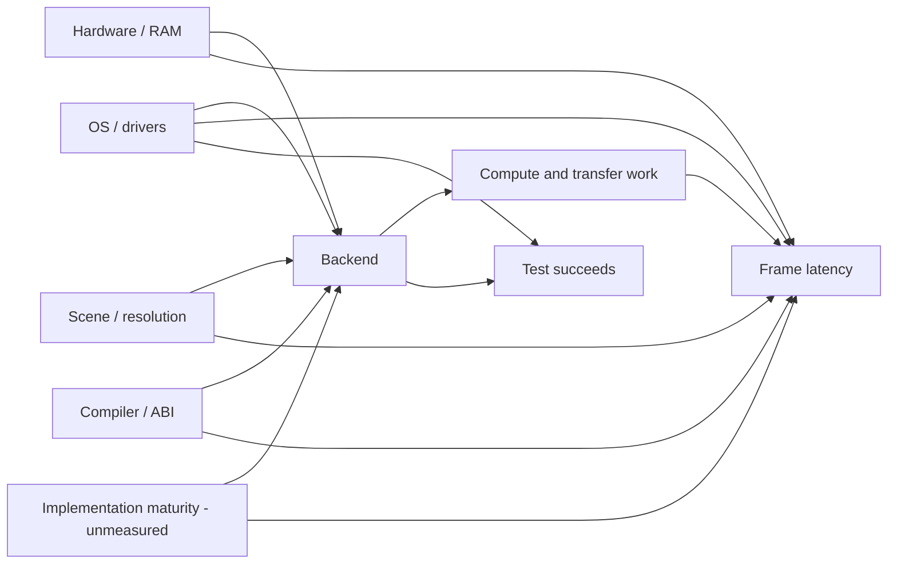

# Rendering and portability experiments — registry and method

**Status:** Proposed workflow and the **authoritative experiment registry**, 2026-11-12, condensed 2026-11-13. Nonbinding: no experiment has been run by this note, no machine access is authorized, no release gate is created. It is not a second roadmap or benchmark suite. Experiments owned by an existing issue or PR are listed here only as pointers, so each experiment has one definition.

**Method:** the owner's [representing-and-intervening](https://github.com/jackwillis/claude-plugins/blob/main/systems-analysis/skills/representing-and-intervening/SKILL.md) and [causal-analysis](https://github.com/jackwillis/claude-plugins/blob/main/systems-analysis/skills/causal-analysis/SKILL.md) skills: represent → predict → intervene → observe → update, with a stated estimand and a DAG before attributing cause. Scale the formality to the cost of being wrong; most entries below need only the table row.

**Evidence and owners:** [G4 integration report](../perf/renderer-integration-20261110.md), [G4 validation](../perf/g4-validation-20261110.md), [scaling](../perf/scaling.md), [benchmark procedure](../g4-benchmark.md), and issues [#18](https://github.com/jackwillis/globe/issues/18), [#34](https://github.com/jackwillis/globe/issues/34), [#36](https://github.com/jackwillis/globe/issues/36), [#59](https://github.com/jackwillis/globe/issues/59), [#64](https://github.com/jackwillis/globe/issues/64), [#72](https://github.com/jackwillis/globe/issues/72), [#97](https://github.com/jackwillis/globe/issues/97), [#114](https://github.com/jackwillis/globe/issues/114). Backend concepts: [PR #112](https://github.com/jackwillis/globe/pull/112). Platform and disc research: [PR #111](https://github.com/jackwillis/globe/pull/111).

## What we know already

The 2026-11-10 integration report measured on **NetBSD 11.1/macppc** (one 7400, 256 MiB), headless `globe-bench`, 640x480, radii 220 and 440, with staged A/B/B/A runs, one discarded warm-up and nine fresh-process measurements per block, retained outliers and exact final-frame hashes. Per-pass lists, then ocean skipping, reduced the **CPU-side** r220 settle median from 505.27 to 396.44 ms and, in a separate matched stage, from 391.51 to 259.70 ms. This is not display submission, not bare OS 9, and not a total-application speedup claim. A faster microkernel, lower CPU-frame time and faster first-visible frame are different outcomes, and reports from different source revisions are not contemporaneous trials.

## Causal model (hypotheses, not learned edges)

Primary estimand: the within-environment effect of replacing the **CPU/native-presentation control** with a **specified treatment backend** on median and tail latency from render request to a fully displayed settled frame, for one camera trace, atlas, resolution, quality, build and physical machine. Secondary outcomes: first useful frame, worst input delay, memory peaks, geographic correctness. An across-OS difference is never reported as a backend effect; if "OpenGL" is software-only, that arm is *software GL*.



```json
{"edges": [["Hardware","Backend"],["Hardware","Latency"],["OSDriver","Backend"],["OSDriver","Latency"],
           ["Workload","Backend"],["Workload","Latency"],["Build","Backend"],["Build","Latency"],
           ["ImplementationMaturity","Backend"],["ImplementationMaturity","Latency"],
           ["Backend","ComputeTransfer"],["ComputeTransfer","Latency"],
           ["Backend","TestPass"],["OSDriver","TestPass"]],
 "treatment": "Backend", "outcome": "Latency", "unobserved": ["ImplementationMaturity"]}
```

**Checker result (run 2026-11-13 with the skill's `dag_check.py`, from outside this repository, on exactly this spec):** five open backdoor paths (through Hardware, OSDriver, Workload, Build and ImplementationMaturity) and **not identifiable by backdoor adjustment** while implementation maturity is unmeasured. `ComputeTransfer` is a mediator and `TestPass` a descendant of the treatment: neither may be adjusted for, and a set containing them is reported invalid. Consequence: do not compare existing arbitrary binaries observationally.

**Design that follows:** a controlled intervention within one machine and OS, so hardware, OS/driver, workload and build are held constant rather than adjusted for. The residual threats are not in the graph and must be handled by protocol: run order and thermal drift, treatment bundling (a source change that differs between arms is part of the treatment, e.g. tessellation or style changes), the timing boundary (fence versus none), and missing latency for failed runs. Record failed runs as their own outcome rather than selecting on `TestPass`.

## Registry

Every executed entry records its **prediction before execution**: the metric, the comparison, the expected direction, and the observation that would refute it. Magnitudes and thresholds are set by the experimenter before the run and written down; none is invented here.

### Active (testable now, subject to authorization noted)

| ID | Question / competing models | First discriminating test | Prediction to record first | Owner |
| --- | --- | --- | --- | --- |
| **EXP-01 stage decomposition** | CPU projection/fill vs RGB conversion vs CopyBits/X upload dominates settle-to-display | Same scene at 320x240, 640x480 and 1024x768; time each stage and the actual on-screen turn. Host and headless NetBSD parts need no new access; the OS 9 convert/CopyBits split needs an authorized session | Which stage's share changes with viewport size, and in which direction; refuted if projection/fill share does not move across sizes while conversion/submission does not grow | #18, #59, #64 |
| **EXP-03 GL capability probe** | Genuine hardware OpenGL vs software renderer vs no GL on a given OS | **Read-only** record of OS/driver, `GL_VENDOR`/`GL_RENDERER`/`GL_VERSION`, pixel formats, and one test triangle. Independent of any decision to implement GPU rendering; installs, display-depth changes and benchmarks are outside its scope | Which of the three each authenticated OS reports; a software-only result is a valid negative outcome. The G4's graphics hardware is not documented in this repository and must be identified, not assumed | Research only |

### Owned elsewhere (pointers; not redefined here)

| ID | Where defined | Note |
| --- | --- | --- |
| **EXP-02 SIMD (AltiVec)** | #97 / #64 | **Conditional research option, not ruled out.** Existing #64 and #97 evidence (host counts and PPC32 codegen, not G4 measurements) points first at per-scanline setup and 64-bit conversion/divide library calls, and #64 notes pixel conversion needs no AltiVec. Revisit if a measured stage is vectorizable pixel work. If run: scalar vs auto-vectorized vs explicit kernel, exact output, end-to-end replay, Retro68 ABI costs recorded separately |
| **EXP-05 display depth vs. detail quality** | #34 | Treat depth conversion and geographic fidelity as separate interventions; never change display settings silently |
| **EXP-06 glyph masks vs. native text** | #36 | Alternative, not adopted. Needs the native-drawing baseline named in `text-layout.md` first, plus the memory and licensing review in `typography.md` |
| **EXP-08 shared presentation** | #114 | Host-only prototype with synthetic fixtures; the single navigation journey is defined in the [PR #110](https://github.com/jackwillis/globe/pull/110) contract |
| **EXP-09 hybrid disc** | [PR #111](https://github.com/jackwillis/globe/pull/111), #72 | Small HFS/ISO image with an identical pack checksum; resource-fork integrity needs a genuine Mac |

### Parked hypotheses

| ID | Hypothesis | Preconditions to unpark | Stop condition |
| --- | --- | --- | --- |
| **EXP-04 GPU geometry** | GL geometry rendering beats CPU fills, vs driver/submit overhead dominating | EXP-03 shows genuine hardware GL on the target OS *and* EXP-01 shows fill or presentation dominates. Then, within one OS: A CPU+native, B CPU+GL upload, C GL geometry on a matched prepared scene, with predefined timing boundary, synchronization and quality tolerance | Software-only GL on that OS; or only presentation improves (then B, not C, is the answer) |
| **EXP-07 executor** | More cores help vs synchronization and scratch costs dominate | A multi-core target that matters to the project, with the cooperative single-core path intact; same job, 1 vs N bounded workers, cancellation and final-result checks | No equivalent final image, any data race, or a harm to the single-core path |

## Protocol

1. **Represent:** state a preferred model and at least one plausible alternative; list hardware, OS build, GPU/driver, exact source commit, toolchain, and whether the environment is real or emulated; inventory existing tests before writing new ones.
2. **Predict first:** as above. Identify a result that would change the decision.
3. **Intervene narrowly:** one explanatory variable where possible, isolated build outputs and machine state. On authentic machines perform only owner-authorized actions: do not install Xcode, switch display depths, reboot, burn discs, change drivers or launch benchmarks without a separately approved session.
4. **Observe:** verify the backend actually used; collect per-trial timings, hashes or geometry comparisons, payload/OS peaks (Classic partition separately), first frame, complete frame and input delay; note cold/warm state, outliers, failures, driver logs. Measurements must say whether they are headless or on-screen.
5. **Update:** if only the magnitude differs, refine thresholds; if the direction or structure differs, revise the model. No cherry-picking, and no causal claim from an observational comparison.

Default reproducibility: matched A/B/B/A where feasible, fresh-process rounds, declared warm-ups and repeats, fixed CPU/driver configuration, timestamped samples, robust median and tails with uncertainty ([benchmark procedure](../g4-benchmark.md)). A/B/B/A balances some drift but not thermal, cache or persistent-state confounding. GPU timing needs completion synchronization that does not distort the target experience. Do not use emulated timings for physical G4 performance.

## Evidence levels

| Environment | Can establish | Unavailable / unproven |
| --- | --- | --- |
| Linux CI, host benchmarks, sanitizers | Build/correctness, controlled host A/B, structured JSON, image checks | PPC timing, historic drivers |
| NetBSD 11/macppc G4 | Real G4 CPU paths, framebuffer timings, AltiVec | Hardware GL until identified |
| Tiger 10.4 G4 | Driver/OpenGL probe, comparative CPU/GL timing | No capability inventory yet; Xcode/SDK use needs separate approval |
| Bare Mac OS 9 | Actual QuickDraw, fonts, depth, responsiveness | No unattended access; MP Services and AltiVec compatibility unproven |
| Wine / ReactOS / QEMU | Windows-style smoke and ABI checks | Not native Win9x/NT proof or physical performance |

## Result record (schema proposal; no measurements included)

```json
{
  "id": "EXP-01", "status": "planned", "hypothesis": null,
  "treatment": null, "control": null,
  "prediction": {"metric": null, "comparison": null, "direction": null, "refuted_if": null},
  "primary_metric": null, "secondary_metrics": [], "correctness": null,
  "machine": null, "os_driver": null, "source_sha": null, "compiler_flags": null,
  "workload_hash": null, "ordered_samples": [], "failed_trials": [], "conclusion": "not tested"
}
```

## Promotion policy

Each experiment ends as **adopt**, **reject**, **revise model and repeat**, or **defer for missing capability**. Keep raw results, negative outcomes, source/hardware identities, the prediction and the reason. Before changing a shared renderer, format or API, run the propagation review and open a focused implementation issue or ADR. The CPU renderer is the stable reference; any new backend is optional. No milestone or physical-media requirement follows.

## Negative and limiting findings (kept discoverable)

- X11 2D acceleration does not imply OpenGL hardware acceleration; a software-GL result is a valid outcome (EXP-03).
- Pixel-loop SIMD is not the first-order cost in the evidence so far (#64/#97); AltiVec is conditional, not disproven (EXP-02).
- A CPU benchmark cannot prove presentation costs; a GL test triangle is a capability probe, not a terrain-performance claim.
- Historical reports from different source revisions must not be pooled as if randomized; across-OS differences are not backend effects.
- Observational comparison of existing binaries is not identifiable from this DAG (checker result above).
