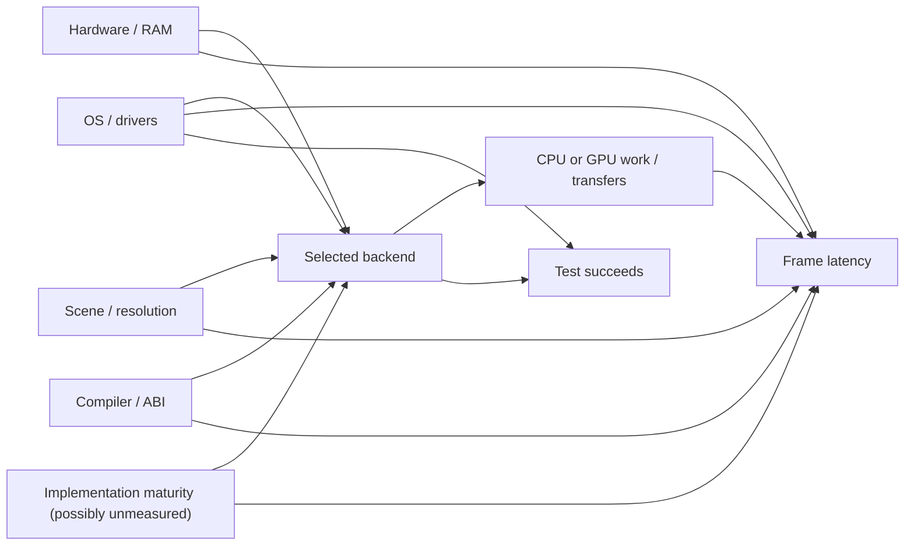

# Causal rendering and portability experiments — research program

**Status:** Proposed scientific workflow, 2026-11-12. No experiments performed by this note, no machine access authorized, no new release gates. This is not a second roadmap or benchmark suite.

**Methodological sources:** [representing-and-intervening](https://github.com/jackwillis/claude-plugins/blob/main/systems-analysis/skills/representing-and-intervening/SKILL.md) and [causal-analysis](https://github.com/jackwillis/claude-plugins/blob/main/systems-analysis/skills/causal-analysis/SKILL.md) in the owner's Claude plugins. They require *represent -> predict -> intervene -> observe -> update*, a predeclared estimand, a DAG, and a backdoor/identifiability check before causal attribution.

**Current evidence and owners:** [G4 integrated rendering experiment](../perf/renderer-integration-20261110.md), [G4 validation](../perf/g4-validation-20261110.md), [scaling report](../perf/scaling.md), [benchmark procedure](../g4-benchmark.md), [#18 latency](https://github.com/jackwillis/globe/issues/18), [#97 falsification and PPC codegen](https://github.com/jackwillis/globe/issues/97), [#34 quality tiers](https://github.com/jackwillis/globe/issues/34), [#36 labels](https://github.com/jackwillis/globe/issues/36), [#59 diagnostics](https://github.com/jackwillis/globe/issues/59), and [#72 optical I/O](https://github.com/jackwillis/globe/issues/72). Backend architecture is a separate proposal, not an established implementation.

## What do we know already?

Globe has headless test programs (`globe-refine-profile`, `globe-line-layer-bench`, pixel conversion/scaling and trace replay) and reproducible G4 benchmark records. The 2026-11-10 report used staged A/B/B/A comparisons, matched G4 CPU and workload, separate baselines, retained outliers and exact final-frame hashes. Per-pass lists and ocean skipping reduced the **CPU-side** 640x480 r220 settle medians from 505.27 to 396.44 ms and from 391.51 to 259.70 ms in separate matched stages. This is **not** a new experiment, nor does it measure display submission or justify a total app speedup claim.

Be careful: a faster microkernel, lower CPU-frame time and faster *first-visible frame* are different outcomes. Do not pool historical reports from differing source revisions as if they were contemporaneous randomized trials.

## The questions on Pearl's ladder

- **Rung 1, observation:** Does a NetBSD test correlate with better G4 timing than a Tiger test? By itself it does not isolate OS or renderer effects.
- **Rung 2, intervention:** On the same machine, OS, resolution, scene, data, build conditions and driver, what changes if we choose a specified backend or CPU kernel rather than a matched control?
- **Rung 3, counterfactual:** Would this particular skipped frame have been faster under another implementation? We can estimate a paired *distribution* under repeatable workloads, not observe both outcomes for the exact same unrepeatable runtime state.

### Primary rendering estimand

The within-environment effect of changing **CPU/native presentation (control)** to **verified hardware OpenGL geometry rendering (treatment)** on median and tail latency from render request to a fully displayed settled frame, for a specified camera trace, atlas, resolution, quality, build and physical machine. Secondary outcomes are first useful frame, worst input delay, memory peaks, power/CPU where measurable, and geographic correctness.

Do **not** report an across-OS difference as the backend effect. GPU capability is a prerequisite, not a treatment. If OpenGL is software-only, explicitly mark that arm as *software GL*.

### Causal model (hypotheses, not learned edges)



Machine-readable *illustrative* DAG for the [causal-analysis solver](https://github.com/jackwillis/claude-plugins/blob/main/systems-analysis/skills/causal-analysis/dag_check.py):

```json
{
  "edges": [
    ["Hardware", "Backend"], ["Hardware", "Latency"],
    ["OSDriver", "Backend"], ["OSDriver", "Latency"],
    ["Workload", "Backend"], ["Workload", "Latency"],
    ["Build", "Backend"], ["Build", "Latency"],
    ["ImplementationMaturity", "Backend"],
    ["ImplementationMaturity", "Latency"],
    ["Backend", "ComputeTransfer"], ["ComputeTransfer", "Latency"],
    ["Backend", "TestPass"], ["OSDriver", "TestPass"]
  ],
  "treatment": "Backend",
  "outcome": "Latency",
  "unobserved": ["ImplementationMaturity"]
}
```

**Identification:** Observational comparison of existing arbitrary binaries is threatened by open backdoor paths through hardware, OS/driver, workload, build and potentially unmeasured implementation maturity. Conditioning on the post-treatment `ComputeTransfer` mediator would hide part of the backend effect. Selecting only `TestPass` runs can bias the comparison because backend and driver both determine test eligibility/success. Do not claim observational identifiability merely because the solver accepts a measured adjustment set: implementation maturity may remain unobserved. Instead build a matched controlled intervention within each OS and record *failed* runs as a separate outcome. Any source changes that differ between arms must be documented as part of the treatment.

For each experiment run the actual repository `dag_check.py` on its final spec (from a pinned revision); store its backdoor/identifiability report, then interpret whether randomization/controls solve the actual question. The above graph is a research template, **not a solver result**.

## Experiment register: minimal, discriminating studies

| ID | Question / competing models | First discriminating test | Decision owner |
| --- | --- | --- | --- |
| **EXP-01 cost decomposition** | CPU projection/fill vs conversion/CopyBits/X upload dominates | Same scene at 320x240/640x480/1024x768; measure each stage *and* actual on-screen turn | #18, #97 |
| **EXP-02 SIMD** | Arithmetic/vectorizable pixel loops vs branch/memory bound | Scalar vs compiler auto-vectorized vs explicit `<altivec.h>` on one kernel; exact output and end-to-end replay | #97 |
| **EXP-03 GL capability** | Real Rage 128 hardware GL vs software renderer/no GL | Record OS/driver/`GL_VENDOR`/`GL_RENDERER`/`GL_VERSION`, pixel formats, test triangle and timing validity | Research only |
| **EXP-04 backend effect** | GPU geometry raster wins vs driver/submit overhead dominates | Within **one OS**: CPU-native, CPU+GL upload, GL geometry; matched trace, input and quality | Research only |
| **EXP-05 adaptive display** | Selected screen depth/quality benefits responsiveness vs merely changes conversion | Factor display depth and geographic fidelity separately, preserve readability and image correctness | #34 |
| **EXP-06 cartographic typography** | Native platform text cheaper vs system glyph masks + shared compositor cheaper for dynamic labels | Cached/uncached glyphs, label count, real OS font fallback, cache memory | #36, #61 |
| **EXP-07 executor** | Work can run on more cores vs sync/scratch costs dominate | Same CPU kernel/job, 1 vs N workers with bounded memory, cancellation and final result checks | #16, #59 |
| **EXP-08 shared presentation** | One semantic Presentation Model cuts drift vs adds complexity | One selection->card->navigation vertical slice on OS 9 and Unix with tests | #3, #23 |
| **EXP-09 hybrid disc** | One shared pack efficiently accessible across OS views vs optical layout/metadata imposes cost | Small HFS/ISO test image with identical checksum and authentic Mac resource forks | #31, #72 |

### Predicted observations and stop criteria

**EXP-01:** At larger viewports, color conversion and display submission may become a growing fraction of latency. A CPU-only benchmark cannot prove this; collect native presentation timings. Revise the model if projection/fill dominates across sizes.

**EXP-02:** bulk pixel conversion and glyph coverage are more plausible AltiVec wins than branch-heavy horizon clipping. Stop if correctness diverges or if the measured end-to-end improvement is absent despite a microbenchmark gain; record compilation/runtime ABI limitations separately for Retro68.

**EXP-03:** X11 2D acceleration does **not** imply OpenGL hardware acceleration. Stop GPU tests on a given OS if only software GL is available; that's a valid negative result. A test triangle is a capability probe, not a terrain-performance claim.

**EXP-04:** GPU geometry *might* accelerate terrain fills/lines, whereas a CPU-generated bitmap uploaded to GL may only improve presentation. To distinguish, benchmark A: CPU+native, B: CPU+GL upload, C: actual GL geometry with prepared matching scene; predefine timing boundaries, GL synchronization and render quality tolerance. Do not confuse changes in tessellation/style with a backend speedup.

**EXP-05:** lower color depth should initially affect **output palette/conversion** without forcing a loss of geographic detail. Quality (low/medium/high) is a separate intervention. Record display-depth changes without silently modifying user settings. Preserve look (Map/Relief) as another independent dimension.

**EXP-06:** native-font glyph-masks might enable efficient compositing and consistent overlay stages, but extraction/caching can cost more. The current [text-layout note](../design/text-layout.md) recommends native drawing; do not supersede without measured evidence and licensing review.

**EXP-07:** worker concurrency may improve responsive I/O and parallel CPU throughput on modern platforms. Single-core Classic Mac must retain the deterministic cooperative execution path; OS 9 MP tasks cannot call arbitrary Toolbox functions. Record scratch/stack memory and stale-generation rejection.

**EXP-08:** the abstraction is accepted only if it reduces duplicated *semantic decisions* or enables a third frontend; never count shared lines as the only outcome. Existing small duplication may be cheaper than generalized interfaces.

**EXP-09:** validate on the actual target OS/media and distinguish replicated directory entries from replicated physical data. Do not burn a disc or change pack formats merely to run the test.

## Experimental protocol

1. **Represent:** state one preferred and at least one plausible alternative causal model. List known hardware, OS build, GPU/driver, clocks, exact source commit, toolchain and real versus emulated environment. Inventory existing tests before writing new ones.
2. **Predict first:** select primary estimand, treatment/control, workload, correctness oracle, direction and plausible minimum useful effect *before* execution. Identify a failure/negative result that would change the decision.
3. **Intervene narrowly:** isolate build outputs and machine state. Change one explanatory variable where possible. On an authentic machine perform only owner-authorized actions; **do not install Xcode, switch display depths, reboot, burn CDs, change system drivers, or launch benchmarks on the G4 without a separately approved session**.
4. **Observe:** verify hardware/software backend, collect per-trial individual timings, hashes/geometry comparisons, peak payload/OS RSS/Classic partition separately, first frame, complete frame and input delay. Record cold/warm cache status, outliers, test failures and driver logs.
5. **Update:** compare prediction and observed distribution. If only effect magnitude differs, refine thresholds; if direction/structure differs, revise the causal graph. Do not cherry-pick a faster case or turn an observational comparison into a causal claim.

**Default reproducibility**: matched A/B/B/A order where feasible, fresh-process rounds or isolated runs, declared warmups and reasonable repeats, CPU/driver configuration held fixed, timestamped samples and robust median/tails with uncertainty. Use existing [G4 benchmark procedure](../g4-benchmark.md). A/B/B/A balances some drift but doesn't by itself eliminate thermal, cache, temporal or persistent-state confounding. For GPU timing include command completion/fence or appropriate synchronization (without letting sync distort the target experience). Do not rely on emulated timings for physical G4 performance.

## Evidence levels and missing access

| Environment | What it can establish | What remains unavailable/unproven |
| --- | --- | --- |
| Linux CI, host benchmarks, sanitizers | Build/correctness, controlled host A/B, structured JSON, image checks | Bare PPC timing, historic driver availability |
| NetBSD 11/macppc G4 | Genuine G4 CPU paths, AltiVec, OS framebuffer timings when run | Hardware OpenGL until renderer/driver verified |
| Tiger 10.4 G4 | Driver/OpenGL probe, CPU/GL comparative geometry and presentation | Currently no authenticated capability/latency inventory; Xcode/SDK availability requires independent approval |
| Bare Mac OS 9 | Actual QuickDraw, preferences, font metrics, pixel-depth, responsiveness | No unattended target access; MP Services/AltiVec compatibility unproved |
| Wine / ReactOS / QEMU | Windows-style smoke and ABI/API verification | Not native Win9x/NT compatibility proof or physical performance |
| Genuine Windows/modern Unix | Authenticated platform behavior and eventual multi-core/GPU tests | Need hardware/guest matrix and tested binaries |

## Suggested result record (schema proposal; no fabricated measurements)

```json
{
  "id": "EXP-02",
  "status": "planned",
  "hypothesis": "SIMD accelerates conversion without compromising pixels",
  "treatment": "explicit-altivec",
  "control": "scalar-reference",
  "primary_metric": "full_frame_latency_ms",
  "secondary_metrics": ["conversion_ms", "peak_bytes", "worst_input_delay_ms"],
  "correctness": "exact-pixel-reference",
  "machine": null,
  "os_driver": null,
  "source_sha": null,
  "compiler_flags": null,
  "workload_hash": null,
  "ordered_samples": [],
  "failed_trials": [],
  "conclusion": "not tested"
}
```

## Promotion policy

An experiment yields one of: **adopt**, **reject**, **revise model / repeat**, or **defer for missing capability**. Keep raw results, negative outcomes, source/hardware identities, the prediction and reason. Before changing a shared renderer/format/API, run the propagation review and open a separate focused implementation issue or ADR. The existing CPU renderer is the stable reference; new backends are optional. No release milestone or physical-media requirement follows from this registry.

**First proposed work:** EXP-01 instrument stage timing and native presentation with minimal overhead; EXP-03 read-only GL capability probe on authenticated OS builds; EXP-02 SIMD microkernel in an isolated NetBSD scratch build. Do not begin EXP-04 until EXP-03 identifies suitable hardware GL.