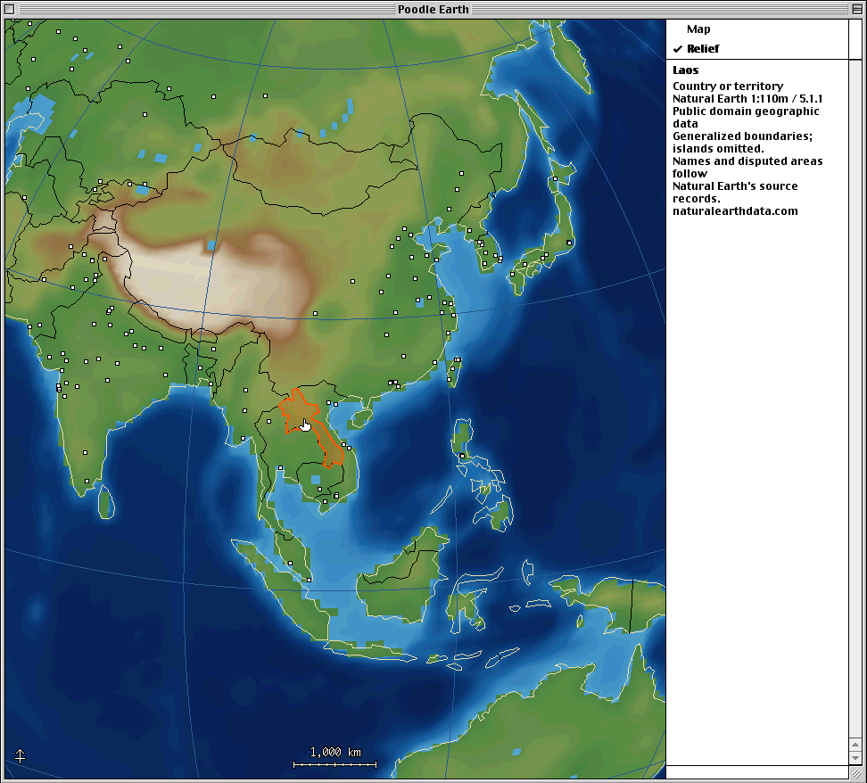
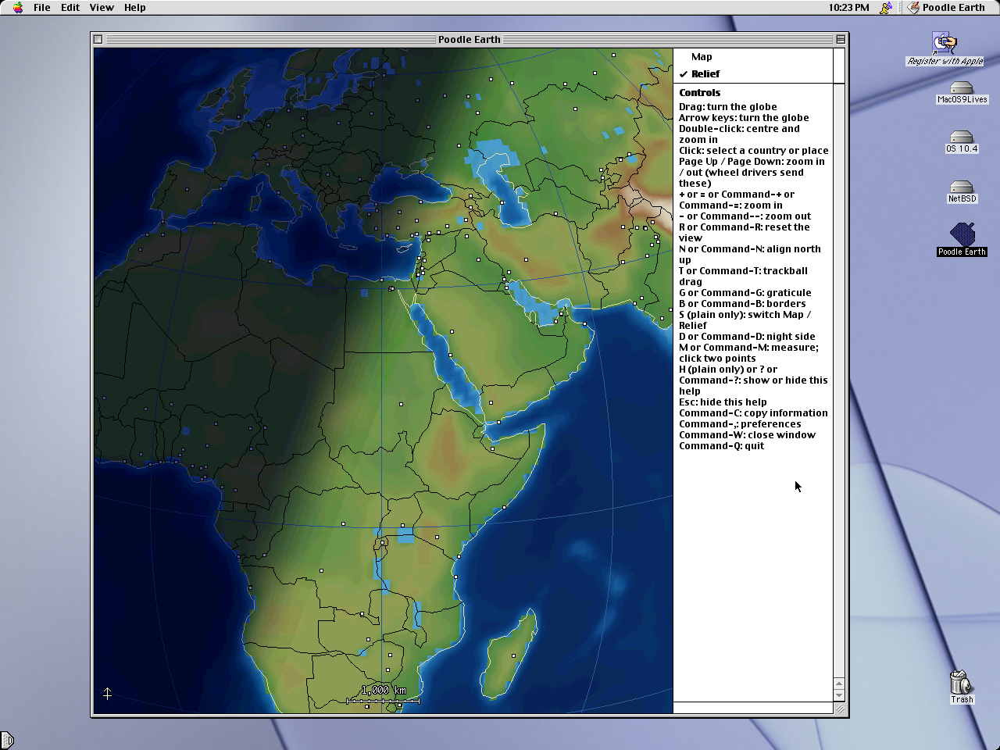

# Poodle Earth user guide

Poodle Earth is an offline globe for PowerPC Classic Macs. This guide covers the
published [v0.1.1 release](https://github.com/jackwillis/poodle-earth/releases/tag/v0.1.1).

## Install from StuffIt

1. Download the `.sit` archive from the release page. Matching source and checksums are available on the same page.
2. Transfer the archive intact to the Mac and expand it with **StuffIt Expander**.
   The package contains the Poodle Earth application, ReadMe, two License files
   (the GPL split for SimpleText) and DataCredit. Keep these together in a folder
   on a writable Macintosh disk.
3. Double-click **Poodle Earth** in Finder. No installer or network is needed.

Expand on the Mac and copy in Finder so the application's **resource fork** and
Finder information survive. Extracting only the data fork through an ordinary
ISO reader, Unix copy or file-sharing path that discards Mac metadata can leave
an application that Finder will not launch. Transfer the archive rather than an
unwrapped application when that path is uncertain.

## Install from an ISO or CD

Download the hybrid ISO from the [v0.1.1 release](https://github.com/jackwillis/poodle-earth/releases/tag/v0.1.1).
The [CD guide](os9-cd-image.md) describes the format and test evidence.

1. In a compatible **PowerPC** Mac emulator, attach the image to the virtual
   **CD-ROM drive**. Start your existing Mac OS guest; this disc contains the app
   and notices, not a bootable system or an OS installer.
2. Open the Poodle Earth CD volume in the guest's Finder.
3. Make a folder on the guest's writable hard disk. Drag **Poodle Earth**, ReadMe,
   both License files and DataCredit into it in Finder, then launch the copy.
   Finder uses the HFS view and preserves both forks; StuffIt is unnecessary.

Jack launched the tested image directly from CD and after copying in ClassicMac
4.7.0 (emulated G4, Mac OS 9.2.1), and tested the burned disc on a physical G4
under bare Mac OS 9.2.2. This is evidence for that image and those environments.
Copying to disk is the recommended installation path. On CD the memory settings
in Get Info are read-only; they become editable on the hard-disk copy after quit.

## Turn, zoom and select

| Action | Control |
| --- | --- |
| Turn the globe | Drag, or use arrow keys |
| Center and zoom in | Double-click a point |
| Zoom | `+` or `=`, `-`, or Page Up / Page Down |
| Reset the view | `R` |
| Align north up | `N` |
| Switch north-up / trackball dragging | `T` |
| Switch Map / Relief | Sidebar, View menu, or plain `S` |
| Toggle graticule / borders | `G` / `B` |
| Toggle night side | `D` |
| Measure | `M`, then click two points on the globe |
| Copy the selected information | Edit > Copy or Command-C |
| Preferences | Edit > Preferences or Command-comma |
| Quit | File > Quit or Command-Q |

Click a country or nearby city to show its information card. A selected country
has an orange outline and dither fill. A click on the sea clears selection.
While moving, the app draws simpler lines; after stopping, terrain fills in
progressively. Allow refinement to finish before judging the final image.

Map colors land by biome class over a blue sea. Relief uses elevation tinting.
Night shading uses the Mac's clock and time-zone settings; check those if the
terminator seems misplaced. Measurement shows a great-circle distance and
bearing, rather than a road route. Edit > Preferences selects metric or imperial
units. Preferences are held for the session and are not saved to disk. The UI
is English-only; place names are ASCII.

## Scale, compass and controls help

Current main adds a distance scale calibrated at the map center and a compass rose
that follows the view's north. The scale follows the units preference and stays
visible during movement. It is a local scale on a globe, not a constant distance
for every point in the picture.

Press `H` or `?`, or choose Apple menu > Controls, to show the current shortcut
list in the information pane. Escape hides it. The list includes Command-key
alternatives: for example `G` and Command-G both toggle the graticule. `S` and
`H` are plain keys only; window closing, quitting, Preferences and copying use
Command-W, Command-Q, Command-comma and Command-C. Plain Q and Escape do not
quit on Classic. Command-= also zooms in.

The images in this guide were captured by Jack on bare Mac OS 9.2.2 using build
`110a197` on November 17, 2026. They show development changes after v0.1.0.
[Capture provenance and lossless conversion](images/os9/README.md).

## Memory and troubleshooting

- **Small window or refused enlargement:** quit the app, select its hard-disk
  copy in Finder, and open File > Get Info > Memory. The default preferred size
  is 24 MB and minimum is 12 MB. Raise Preferred if enough RAM is available.
  Window size is bounded by available application memory. Current main explains
  a refused enlargement once per session; v0.1.0 does not show that explanation.
- **Application will not open:** confirm the guest is PowerPC, copy again using
  Finder or re-expand the `.sit` on the Mac, and check free memory. The original
  v0.1.0 has an AppearanceLib dependency that fails on Mac OS 8.1. A later
  QuickDraw-cursor fix has [owner-reported emulator smoke tests](https://github.com/jackwillis/poodle-earth/issues/174#issuecomment-6969352476)
  on PowerPC System 7.1.2 through Mac OS 8.5; these do not establish every machine
  and OS combination or change the original release's requirements.
- **Wheel does nothing:** Classic has no native scroll-wheel input here; use
  Page Up / Page Down or `+` / `-`. A wheel driver may map to those keys.
- **Unfinished globe edge in v0.1.0:** turn or zoom to repaint. Jack subsequently
  reported sustained use without recurrence; this was not a structured proof.
- **Missing island, country or city:** this compact atlas uses 1:110 million-scale
  outlines, one-degree terrain and 304 cities. It is not a street atlas.

## Unix source builds

The X11 frontend shares the core but has its own toolbar and looks palette.
It accepts mouse-wheel zoom, `P` for the looks palette and F2 to restore the
hidden toolbar. Q or Escape quits (Escape hides Controls first). Do not use
Classic's Command-key instructions as an X11 shortcut reference. See
[Contributing](../CONTRIBUTING.md) for builds and test evidence.
